# Diagrams

All project diagrams in one place, in Mermaid. They render on GitHub, in VS Code (with a Mermaid extension) and at mermaid.live.
Each section has a short explanation to use when presenting it.

| # | Diagram | What it answers |
|---|---|---|
| 1 | [Product overview and scenario flows](#1-product-overview) | What are we building, and what happens in each kind of call? |
| 2 | [One-page call flow (presentation version)](#2-one-page-call-flow) | How does one call move through every scenario? (slide version) |
| 3 | [Authentication and verified bank access](#3-authentication) | How is a caller verified, and how is their data protected? |
| 4 | [Current dev setup (how the system works today)](#4-current-dev-setup) | How does the system work today, part by part? |
| 5 | [Deployed architecture (AWS Mumbai, proposed)](#5-deployed-architecture) | Where will it run in production? |
| 6 | [Early architecture and tech options (2 Nov research)](#6-early-tech-options) | Which tech options did we compare at the start? |
| 7 | [Timeline A: one caller turn, our container mostly waits](#7-one-turn-timeline) | Where does the time go in one turn? (Excalidraw chart A) |
| 8 | [Timeline B: while call A waits, the container listens to B, C and D](#8-many-calls-timeline) | Why can one container take several calls? (Excalidraw chart B) |
| 9 | [Sizing: from one call to the servers](#9-sizing) | How many servers do 100 (or 400) calls at once need? |
| 10 | [Where the money goes each month](#10-monthly-cost) | What does it cost, and what is the biggest item? |
| 11 | [Solution architecture](#11-solution-architecture) | What are the agent's parts (speech in, bot, speech out) and what is around them? |
| 12 | [AWS deployment (pilot)](#12-aws-deployment) | Where does each part run on AWS for the pilot? |
| 13 | [Data flow diagram, level 0](#13-dfd-level-0) | Who sends the system data, and what data? |
| 14 | [Data flow diagram, level 1](#14-dfd-level-1) | Inside the system: steps, data stores, trust boundaries, where personal data goes |
| 15 | [Deploy and update (CI/CD)](#15-deploy-and-cicd) | How does a code change reach the server? |
| 16 | [Sequence: a verified card block](#16-card-block-sequence) | In what order are the controls checked in one action? |
| — | [draw.io versions](#drawio) | Presentation versions (7 files in `docs/diagrams/drawio/`) |
| A | [Appendix: 16 Nov timelines (with an interruption)](#appendix) | A more detailed version of 7 and 8: barge-in, bursts colliding |

## 1. Product overview and scenario flows

**What it is:** the full picture of the product on one page, read top to bottom.

**How to explain it:**
- **① What we are building:** the goal (an agent that knows when to answer, clarify, confirm, act or transfer), what it must do, what the demo must show, and how it is judged.
- **Note (yellow, dashed):** gaps in the dummy data and the KB. Until they are fixed, the agent says "not available" honestly and offers a next step.
- **② Every call must be ready for:** what is asked, what it needs, how people talk, and what can go wrong.
- **③ Call lifecycle:** connect → greet and detect language → listen → decide → answer, act or transfer → "anything else?" → close and write the audit record.
- **④ Decision checks on every turn:** safety, scope, verification, clarity, data, action, then respond.
- **⑤ Front door:** is the caller ID registered, and what do they want? This sends the call to flow A, to verification for B/C/D, or to F.
- **⑥ and ⑦ Scenario groups and flows:** A general info, B personal info, C controlled card actions, D complaints and fraud, E human transfer, F new customer. Each has its own small flow.
- **⑧ Always on:** rules that apply in every scenario (conversation, identity, language, failures, emotion, data). Everything ends in the audit trail.

**Colours:** green = good outcome, red = safe stop or fallback, orange = decision, blue = a human team.

```mermaid
flowchart TB

  TITLE["<b>AU SFB INBOUND VOICE AGENT</b><br/>Multilingual AI voice banking assistant"]:::title

  %% ───────────── STAGE 1 ─────────────
  subgraph S1["① WHAT WE ARE BUILDING"]
    direction LR
    GOAL["<b>Goal</b><br/>A natural, trusted voice agent that knows when to<br/><b>answer · clarify · confirm · act · transfer</b>"]:::core
    MUST["<b>Must be able to</b><br/>• Understand English, Hindi, Hinglish<br/>• Verify the caller before personal info<br/>• Fetch data and do permitted actions<br/>• Confirm before sensitive actions<br/>• Hand off to a human with context<br/>• Keep a full audit trail"]:::box
    DEMO["<b>Demo must show</b><br/>• One general info query<br/>• One personal info query<br/>• One controlled action<br/>• One human transfer"]:::box
    EVAL["<b>Judged on</b><br/>• Natural conversation<br/>• Multilingual understanding<br/>• Journey completion<br/>• Security, controls and audit<br/>• Speed and reliability<br/>• Innovation and demo quality"]:::box
    GOAL ~~~ MUST ~~~ DEMO ~~~ EVAL
  end

  subgraph NOTE["⚠ NOTE: DATA AND KNOWLEDGE GAPS (improve later)"]
    direction LR
    N1["<b>Dummy data (kept as-is)</b><br/>• one FD, loan and card per customer<br/>• no card transactions or block status<br/>• no merchant names or salary flag"]:::note
    N2["<b>Knowledge base</b><br/>• no FD premature penalty<br/>• no Platinum account page<br/>• conflicting loan rate and card fee"]:::note
    N3["<b>Meanwhile</b><br/>Agent says 'not available'<br/>honestly and offers<br/>a next step"]:::note
    N1 ~~~ N2 ~~~ N3
  end

  %% ───────────── STAGE 2 ─────────────
  subgraph S2["② EVERY CALL MUST BE READY FOR"]
    direction LR
    R1["<b>1 · What is asked</b><br/>General info<br/>My account data<br/>An action<br/>A complaint"]:::box
    R2["<b>2 · What it needs</b><br/>Knowledge base only<br/>Caller verification<br/>Verification + confirmation<br/>A human"]:::box
    R3["<b>3 · How people talk</b><br/>Language switching<br/>Corrections, interruptions<br/>Vague details<br/>Several asks at once"]:::box
    R4["<b>4 · What can go wrong</b><br/>Verification fails<br/>Data not available<br/>System slow or down<br/>Misuse attempts"]:::box
    R1 ~~~ R2 ~~~ R3 ~~~ R4
  end

  %% ───────────── STAGE 3 ─────────────
  subgraph S3["③ CALL LIFECYCLE"]
    direction LR
    L1(["Call connects"]):::start
    L2["Greet, AI +<br/>recording notice,<br/>detect language"]:::step
    L3["Listen and<br/>understand"]:::step
    L4["Decide the<br/>next move ④"]:::step
    L5["Answer · Act<br/>or Transfer"]:::step
    L6{"Anything<br/>else?"}:::decision
    L7["Recap and<br/>close"]:::step
    L8[("Audit<br/>record")]:::store
    L1 --> L2 --> L3 --> L4 --> L5 --> L6
    L6 -->|Yes| L3
    L6 -->|No| L7 --> L8
  end

  %% ───────────── STAGE 4 ─────────────
  subgraph S4["④ EVERY TURN: DECISION CHECKS"]
    direction LR
    D1["Safety<br/><i>fraud, panic,<br/>wants a human</i>"]:::check
    D2["Scope<br/><i>allowed on<br/>this call?</i>"]:::check
    D3["Verification<br/><i>needs my<br/>data?</i>"]:::check
    D4["Clarity<br/><i>anything<br/>ambiguous?</i>"]:::check
    D5["Data<br/><i>does it<br/>exist?</i>"]:::check
    D6["Action<br/><i>changes<br/>something?</i>"]:::check
    D7["Respond<br/><i>short, masked,<br/>caller's language</i>"]:::good
    D1 --> D2 --> D3 --> D4 --> D5 --> D6 --> D7
  end

  %% ───────────── FRONT DOOR ─────────────
  subgraph SFD["⑤ FRONT DOOR: WHO IS CALLING + WHAT THEY WANT"]
    direction LR
    W1(["Call starts"]):::start
    W2{"Caller ID<br/>registered?"}:::decision
    W3["Known customer<br/><i>not verified yet</i>"]:::step
    W4["Unknown number<br/><i>may be a customer<br/>on another phone</i>"]:::step
    W5{"What do<br/>they want?"}:::decision
    W6["Flow A<br/><i>no verification</i>"]:::grpA
    W7{"Can they verify?<br/><i>OTP to registered<br/>mobile</i>"}:::decision
    W8["Flow B / C / D"]:::grpB
    W9["Flow F<br/><i>new customer</i>"]:::grpF
    W10["Failed 3×<br/>security event<br/><i>general help or human</i>"]:::bad
    W1 --> W2
    W2 -->|Yes| W3
    W2 -->|No| W4
    W3 --> W5
    W4 --> W5
    W5 -->|General question| W6
    W5 -->|Personal info or action| W7
    W5 -->|Wants to open an account| W9
    W7 -->|Yes| W8
    W7 -->|No account| W9
    W7 -->|Fails| W10
  end

  %% ───────────── STAGE 5 ─────────────
  subgraph S5["⑥ SCENARIO GROUPS"]
    direction LR
    G1["<b>A · General info</b><br/>Products, rates,<br/>suggestions<br/><i>no verification</i>"]:::grpA
    G2["<b>B · Personal info</b><br/>Balances, loans, cards,<br/>transactions<br/><i>read-only, verified</i>"]:::grpB
    G3["<b>C · Controlled actions</b><br/>Block, unblock,<br/>card on/off controls<br/><i>verified + confirmed</i>"]:::grpC
    G4["<b>D · Complaints and fraud</b><br/>Unknown debit, failed txn,<br/>charges<br/><i>protect, then hand off</i>"]:::grpD
    G5["<b>E · Human transfer</b><br/>Asked, frustrated,<br/>sensitive, stuck<br/><i>with context</i>"]:::grpE
    G6["<b>F · New customer</b><br/>No account yet,<br/>wants to open one<br/><i>suggest, then sales</i>"]:::grpF
    G1 ~~~ G2 ~~~ G3 ~~~ G4 ~~~ G5 ~~~ G6
  end

  %% ───────────── STAGE 6: DEEP DIVES ─────────────
  subgraph S6["⑦ SCENARIO FLOWS"]
    direction TB

    subgraph FA["A · General info"]
      direction LR
      A1(["Question"]):::start
      A2{"About my<br/>own account?"}:::decision
      A3["Verify first<br/>→ go to flow B"]:::step
      A4{"In approved<br/>knowledge?"}:::decision
      A5["Clarify if needed<br/><i>tenure, branch type</i>"]:::step
      A6["Short answer<br/>+ offer next step"]:::good
      A7["Say not available<br/>offer transfer or website"]:::bad
      A1 --> A2
      A2 -->|Yes| A3
      A2 -->|No| A4
      A4 -->|Yes| A5 --> A6
      A4 -->|No| A7
    end

    subgraph FB["B · Personal info (read-only)"]
      direction LR
      B1(["Request"]):::start
      B2{"Caller<br/>verified?"}:::decision
      B3["Verify<br/><i>caller ID + OTP</i>"]:::step
      B3X["Failed 3×<br/>general help or human"]:::bad
      B4{"More than<br/>one product?"}:::decision
      B5["List briefly<br/>or ask which one"]:::step
      B6{"Data<br/>exists?"}:::decision
      B7["Fetch and calculate<br/><i>in code, not by AI</i>"]:::step
      B8["Speak result<br/><i>masked, last 4 only</i>"]:::good
      B9["Say what is and isn't visible<br/>offer request or transfer"]:::bad
      B1 --> B2
      B2 -->|No| B3
      B3 -->|Pass| B4
      B3 -->|Fail| B3X
      B2 -->|Yes| B4
      B4 -->|Yes| B5 --> B6
      B4 -->|No| B6
      B6 -->|Yes| B7 --> B8
      B6 -->|No| B9
    end

    subgraph FC["C · Controlled actions"]
      direction LR
      C1(["Action request"]):::start
      C2{"Allowed<br/>on this call?"}:::decision
      C2X["Explain and route<br/><i>e.g. break FD, pay bill</i>"]:::bad
      C3["Verify caller"]:::step
      C4["Identify card<br/><i>type + last 4</i>"]:::step
      C5["Read current state"]:::step
      C6["Confirm in one line<br/><i>what, which card, reversible?</i>"]:::step
      C7{"Clear<br/>yes?"}:::decision
      C7X["Pause, answer,<br/>re-confirm or cancel"]:::step
      C8["Execute"]:::step
      C9{"Result<br/>verified?"}:::decision
      C10["Read back +<br/>reference + SMS"]:::good
      C11["Never claim success<br/>escalate and log"]:::bad
      C1 --> C2
      C2 -->|No| C2X
      C2 -->|Yes| C3 --> C4 --> C5 --> C6 --> C7
      C7 -->|No / unsure / interrupted| C7X
      C7 -->|Yes| C8 --> C9
      C9 -->|Yes| C10
      C9 -->|No / unknown| C11
    end

    subgraph FD["D · Complaints and fraud"]
      direction LR
      E1(["Issue raised"]):::start
      E2{"Fraud<br/>risk?"}:::decision
      E3["Offer card block first<br/>→ flow C"]:::step
      E4["Find the transaction<br/><i>amount, date range</i>"]:::step
      E5["Explain what the<br/>data shows"]:::step
      E6["Log complaint (ticket ID)<br/>or transfer<br/><i>no refund promises</i>"]:::good
      E1 --> E2
      E2 -->|Yes| E3 --> E4
      E2 -->|No| E4
      E4 --> E5 --> E6
    end

    subgraph FE["E · Human transfer"]
      direction LR
      T0(["Trigger"]):::start
      T1["Asked for a human<br/>Frustrated · Sensitive<br/>Low confidence · System down"]:::step
      T0 --> T1
      T2["Build handoff note<br/><i>verified?, language, intent,<br/>what was done, why</i>"]:::step
      T3{"Route to team"}:::decision
      T4["Cards"]:::team
      T5["Fraud and disputes"]:::team
      T6["Loans"]:::team
      T7["Deposits"]:::team
      T8["General care"]:::team
      TA{"Human<br/>available?"}:::decision
      TB["Callback or ticket<br/><i>expected time, logged</i>"]:::bad
      T1 --> T2 --> TA
      TA -->|Yes| T3
      TA -->|No| TB
      T3 --> T4 & T5 & T6 & T7 & T8
    end

    subgraph FF["F · New customer (no account)"]
      direction LR
      F1(["New-customer request<br/><i>e.g. 'first account,<br/>can't keep a minimum balance'</i>"]):::start
      F2["Understand the need<br/><i>1–2 questions</i>"]:::step
      F3["Suggest 2–3 products<br/><i>from approved KB</i>"]:::step
      F4{"Next<br/>step?"}:::decision
      F5["Connect to<br/>sales"]:::team
      F6["Callback request<br/><i>name + number, with consent<br/>no ID documents on call</i>"]:::step
      F7["How to open<br/><i>video KYC, app, branch</i>"]:::good
      F8["Log as lead"]:::good
      F1 --> F2 --> F3 --> F4
      F4 -->|Talk to someone| F5
      F4 -->|Call me later| F6
      F4 -->|Do it myself| F7
      F5 --> F8
      F6 --> F8
    end

    FA ~~~ FB ~~~ FC ~~~ FD ~~~ FE ~~~ FF
  end

  %% ───────────── STAGE 7 ─────────────
  subgraph S7["⑧ ALWAYS ON, ACROSS EVERY SCENARIO"]
    direction LR
    X1["<b>Conversation</b><br/>corrections, topic switch,<br/>'it', vague details,<br/>interruptions"]:::box
    X2["<b>Identity</b><br/>no third-party disclosure<br/>never read full numbers<br/>stop OTP / PIN sharing<br/>voice ≠ identity"]:::box
    X3["<b>Language</b><br/>Hindi · English · Hinglish<br/>follow switches<br/>lakh / rupee amounts"]:::box
    X4["<b>Failures</b><br/>'checking' filler<br/>retry once<br/>never invent values<br/>backup provider<br/>keypad menu"]:::box
    X5["<b>Emotion</b><br/>calm when panicked<br/>human early when angry<br/>slower for elderly"]:::box
    X6["<b>Data</b><br/>redact before LLM<br/>store in India<br/>no training on calls<br/>set retention"]:::box
    X1 ~~~ X2 ~~~ X3 ~~~ X4 ~~~ X5 ~~~ X6
  end

  AUDIT[("<b>AUDIT TRAIL</b><br/>intents · verification · confirmations ·<br/>system calls · outcomes · transfers")]:::store

  %% ───────────── SPINE ─────────────
  TITLE --> S1
  S1 -.- NOTE -.- S2
  S2 --> S3 --> S4 --> SFD --> S5 --> S6 --> S7 --> AUDIT

  %% ───────────── STYLES ─────────────
  classDef title fill:#5B2A86,stroke:#5B2A86,color:#ffffff,font-size:20px
  classDef core fill:#EDE4F7,stroke:#5B2A86,stroke-width:2px,color:#2a1440
  classDef box fill:#ffffff,stroke:#9A86B5,color:#222222
  classDef note fill:#FFF6D6,stroke:#C9A227,stroke-dasharray:6 4,color:#4a3b00
  classDef start fill:#5B2A86,stroke:#5B2A86,color:#ffffff
  classDef step fill:#ffffff,stroke:#888888,color:#222222
  classDef check fill:#F2F2F7,stroke:#6E6E8F,color:#222222
  classDef decision fill:#FFF1E0,stroke:#E08A1E,color:#222222
  classDef good fill:#E3F5E8,stroke:#2E9B57,color:#123d22
  classDef bad fill:#FDE8E8,stroke:#C94141,color:#4a1010
  classDef team fill:#E8F0FD,stroke:#3B6FD1,color:#10264d
  classDef store fill:#EDE4F7,stroke:#5B2A86,color:#2a1440
  classDef grpA fill:#E8F0FD,stroke:#3B6FD1,color:#10264d
  classDef grpB fill:#E3F5E8,stroke:#2E9B57,color:#123d22
  classDef grpC fill:#FFF1E0,stroke:#E08A1E,color:#4a2a00
  classDef grpD fill:#FDE8E8,stroke:#C94141,color:#4a1010
  classDef grpE fill:#F2E8FD,stroke:#7B4FC0,color:#2a1440
  classDef grpF fill:#E6F6F4,stroke:#1F9A8A,color:#0e3d37
  style NOTE fill:#FFFBEA,stroke:#C9A227,stroke-dasharray:6 4
```

## 2. One-page call flow (presentation version)

**What it is:** the same scenarios as the overview, squeezed into one call flow for slides.

**How to explain it:**
- **① Call lifecycle** and **② scenario groups A–F**, as in the overview.
- **③ Complete call flow:** every scenario in one chart. The call starts, we check the caller ID, greet, then ask "what do they want?"
  - **Flow A** (general question) goes to the knowledge base. If the question is about their own account, the caller must verify first.
  - **Flow F** (new customer) suggests 2–3 products, then offers a person, a callback or self-service.
  - **Personal info, actions and issues** all pass through verification first. After 3 failures it becomes a security event.
  - **Flow B** reads data and calculates in code. **Flow C** checks the action is allowed, reads back the change, needs a clear "yes", does it, and never claims success unless the result is confirmed.
  - **Flow D:** if there is fraud risk, block the card (using C's confirm steps) or go straight to the fraud team. Otherwise explain what we see and log a complaint.
  - **Human transfer** can happen at any time. The agent builds a handoff note, then routes to a team, or books a callback or ticket if nobody is free.
- After every outcome: "anything else?"

**Verification** is the caller's registered mobile plus a 6-digit code typed on the keypad (diagram 3 shows the detail). It was "KYC: DOB + address" in the first version of this chart; corrected 17 Nov.

```mermaid
flowchart TB

  TITLE["<b>AU SFB INBOUND VOICE AGENT</b><br/>Multilingual AI voice banking assistant"]:::title

  %% ═════════════ ① CALL LIFECYCLE ═════════════
  subgraph LIFE["① CALL LIFECYCLE"]
    direction LR
    L1(["Call connects"]):::start
    L2["Greet, AI +<br/>recording notice,<br/>detect language"]:::step
    L3["Listen and<br/>understand"]:::step
    L4["Decide the<br/>next move"]:::step
    L5["Answer · Act<br/>or Transfer"]:::step
    L6{"Anything<br/>else?"}:::decision
    L7["Recap and<br/>close"]:::step
    L8[("Audit<br/>record")]:::store
    L1 --> L2 --> L3 --> L4 --> L5 --> L6
    L6 -->|Yes| L3
    L6 -->|No| L7 --> L8
  end

  %% ═════════════ ② SCENARIO GROUPS ═════════════
  subgraph GROUPS["② SCENARIO GROUPS"]
    direction LR
    G1["<b>A · General info</b><br/>Products, rates,<br/>suggestions<br/><i>no verification</i>"]:::grpA
    G2["<b>B · Personal info</b><br/>Balances, loans, cards,<br/>transactions<br/><i>read-only, auth customer</i>"]:::grpB
    G3["<b>C · Controlled actions</b><br/>Block, unblock,<br/>card on/off controls<br/><i>auth + confirm, or hand off</i>"]:::grpC
    G4["<b>D · Issues and fraud</b><br/>Unknown debit, failed txn,<br/>charges<br/><i>protect, then hand off</i>"]:::grpD
    G5["<b>E · Human transfer</b><br/>Asked, frustrated, sensitive,<br/>low confidence, system down<br/><i>any time, with context</i>"]:::grpE
    G6["<b>F · New customer</b><br/>No account yet,<br/>wants to open one<br/><i>suggest, then sales</i>"]:::grpF
    G1 ~~~ G2 ~~~ G3 ~~~ G4 ~~~ G5 ~~~ G6
  end

  %% ═════════════ ③ COMPLETE CALL FLOW ═════════════
  subgraph CALL["③ COMPLETE CALL FLOW (all scenarios in one)"]
    direction LR

    %% ── Start ──
    K1(["Call starts"]):::start
    K2{"Caller ID registered?<br/><i>calling phone number vs<br/>registered mobile</i>"}:::decision
    K3["Registered number<br/><i>lighter check later</i>"]:::step
    K4["Unknown number<br/><i>general info only,<br/>or full check</i>"]:::step
    K6["Greet: AI + recording notice<br/><i>detect language</i>"]:::step
    K5{"What do<br/>they want?"}:::decision

    %% ── Auth ──
    AUTH{"Verify caller<br/><i>registered mobile +<br/>6-digit keypad code</i>"}:::decision
    SEC["Failed 3×: security event<br/><i>general help or human</i>"]:::bad
    TYPE{"Info, action<br/>or issue?"}:::decision

    %% ── Flow A ──
    A1{"About my<br/>own account?"}:::fa
    A2{"In approved<br/>knowledge?"}:::fa
    A4["Short answer<br/>+ offer next step"]:::good
    A5["Say not available<br/><i>offer transfer or callback</i>"]:::bad

    %% ── Flow B ──
    B3{"Data<br/>exists?"}:::fb
    B4["Fetch + calculate in code<br/><i>speak masked result</i>"]:::good
    B5["Say what is and isn't visible<br/><i>offer request or transfer</i>"]:::bad

    %% ── Flow C ──
    C1{"Allowed on<br/>this call?"}:::fc
    C2["Explain and route<br/><i>e.g. break FD, pay bill</i>"]:::bad
    C3["Identify card +<br/>read current state"]:::fc
    C4{"Can the agent<br/>do this change?"}:::fc
    C5["Read back the change,<br/>ask for a clear yes<br/><i>warn if permanent change</i>"]:::fc
    C6{"Clear<br/>yes?"}:::fc
    C7["Pause, answer,<br/>re-confirm or cancel"]:::fc
    C8["Perform action"]:::fc
    C9{"Result<br/>verified?"}:::fc
    C10["Read back +<br/>reference + SMS"]:::good
    C11["Never claim success<br/><i>escalate and log</i>"]:::bad

    %% ── Flow D ──
    D1{"Fraud<br/>risk?"}:::fd
    D2{"Block the<br/>card now?"}:::fd
    D4["Tell what we found,<br/>or that it isn't visible"]:::fd
    D5["Log complaint<br/>(ticket ID) or transfer"]:::good

    %% ── Flow F ──
    F1["Understand the need,<br/>suggest 2–3 products<br/><i>from approved KB</i>"]:::ff
    F2{"Next<br/>step?"}:::ff
    F3["Callback request<br/><i>name + number, with consent<br/>log as lead</i>"]:::good
    F4["How to open<br/><i>video KYC, app, branch</i>"]:::good

    %% ── Human transfer ──
    INT["⚡ <b>Any time in the call</b><br/><i>asks for a human · frustrated ·<br/>sensitive · low confidence ·<br/>system down</i>"]:::fe
    H1["Build handoff note<br/><i>verified?, language, intent,<br/>what was done, why</i>"]:::fe
    H2{"Human<br/>available?"}:::fe
    H3["Route to team<br/><i>Cards · Fraud · Loans ·<br/>Deposits · Sales · General</i>"]:::team
    H4["Callback or ticket<br/><i>expected time, logged</i>"]:::bad

    %% ── End ──
    NEXT["<b>After every outcome: Anything else?</b><br/>Yes → back to <i>What do they want?</i><br/>No → recap + close · audit record"]:::store

    %% Start
    K1 --> K2
    K2 -->|Yes| K3
    K2 -->|No| K4
    K3 --> K6
    K4 --> K6
    K6 --> K5

    %% A
    K5 -->|"Flow A · general question"| A1
    A1 -->|Yes| AUTH
    A1 -->|No| A2
    A2 -->|Yes| A4
    A2 -->|No| A5

    %% F
    K5 -->|"Flow F · wants to open an account"| F1
    F1 --> F2
    F2 -->|Talk to someone| H1
    F2 -->|Call me later| F3
    F2 -->|Do it myself| F4

    %% Auth → B / C / D
    K5 -->|"Personal info, action to<br/>perform or facing issue"| AUTH
    AUTH -->|Pass| TYPE
    AUTH -->|No account| F1
    AUTH -->|Fails 3×| SEC

    %% B
    TYPE -->|"Flow B · info only"| B3
    B3 -->|Yes| B4
    B3 -->|No| B5

    %% C
    TYPE -->|"Flow C · action"| C1
    C1 -->|No| C2
    C1 -->|Yes| C3 --> C4
    C4 -->|"No, needs a person"| H1
    C4 -->|Yes| C5 --> C6
    C6 -->|"No / unsure / interrupted"| C7
    C6 -->|Yes| C8 --> C9
    C9 -->|Yes| C10
    C9 -->|"No / unknown"| C11

    %% D
    TYPE -->|"Flow D · issue raised"| D1
    D1 -->|Yes| D2
    D2 -->|"Block → same confirm<br/>steps as C"| C4
    D2 -->|"Straight to fraud team"| H1
    D1 -->|No| D4 --> D5

    %% Human transfer
    INT --> H1
    H1 --> H2
    H2 -->|Yes| H3
    H2 -->|No| H4

    %% Placement only (invisible): keep the "any time" note beside the handoff, and the end note at the far right
    C8 ~~~ INT
    H3 ~~~ NEXT
  end

  TITLE --> LIFE --> GROUPS --> CALL

  %% ═════════════ STYLES ═════════════
  classDef title fill:#5B2A86,stroke:#5B2A86,color:#ffffff,font-size:20px
  classDef start fill:#5B2A86,stroke:#5B2A86,color:#ffffff
  classDef step fill:#ffffff,stroke:#888888,color:#222222
  classDef decision fill:#FFF1E0,stroke:#E08A1E,color:#222222
  classDef store fill:#EDE4F7,stroke:#5B2A86,color:#2a1440
  classDef good fill:#E3F5E8,stroke:#2E9B57,color:#123d22
  classDef bad fill:#FDE8E8,stroke:#C94141,color:#4a1010
  classDef team fill:#E8F0FD,stroke:#3B6FD1,color:#10264d
  classDef grpA fill:#E8F0FD,stroke:#3B6FD1,color:#10264d
  classDef grpB fill:#E3F5E8,stroke:#2E9B57,color:#123d22
  classDef grpC fill:#FFF1E0,stroke:#E08A1E,color:#4a2a00
  classDef grpD fill:#FDE8E8,stroke:#C94141,color:#4a1010
  classDef grpE fill:#F2E8FD,stroke:#7B4FC0,color:#2a1440
  classDef grpF fill:#E6F6F4,stroke:#1F9A8A,color:#0e3d37
  classDef fa fill:#ffffff,stroke:#3B6FD1,stroke-width:2px,color:#10264d
  classDef fb fill:#ffffff,stroke:#2E9B57,stroke-width:2px,color:#123d22
  classDef fc fill:#ffffff,stroke:#E08A1E,stroke-width:2px,color:#4a2a00
  classDef fd fill:#ffffff,stroke:#C94141,stroke-width:2px,color:#4a1010
  classDef fe fill:#F2E8FD,stroke:#7B4FC0,stroke-width:2px,color:#2a1440
  classDef ff fill:#ffffff,stroke:#1F9A8A,stroke-width:2px,color:#0e3d37
  style CALL fill:#FCFCFE,stroke:#5B2A86,stroke-width:2px
```

## 3. Authentication and verified bank access

**What it is:** exactly how a caller gets verified, and how every later personal-data request is protected at the bank.

**How to explain it:**
1. **Call starts:** a session is created in PostgreSQL with `verified = false`.
2. **General questions** (no personal data) are answered from the knowledge base. No verification is needed.
3. **Personal data needed:** the task registry marks it as "verified only" and `auth.start()` runs. We look up the caller's number at the bank using our **service token**. If it isn't registered, we ask for their registered mobile.
4. **OTP:** code makes a random 6-digit code. We store only an HMAC (a keyed fingerprint) of it, never the code itself, and send it by SMS. The caller types it on the **keypad**, so it never goes through speech-to-text or the LLM.
5. **Wrong code:** we count attempts. After 3, the session is locked and the call goes to a human.
6. **Right code:** the session is marked verified with the customer's CIF (customer ID), and we answer the original question.
7. **Every later personal-data turn:** we re-check the session, then mint a short-lived **customer token** (CIF, audience, scopes, expiry). The bank checks **both** tokens and that the CIF in the URL matches the token. If either check fails, the request is rejected.
8. **Call ends:** `auth.end()` clears the verification and forgets any cached customer data.

**Key point:** the agent can never read another customer's data, because the bank itself enforces the customer token.

**Colours:** purple = start and end, orange = a decision made in code, lilac = the secret steps (the code and the customer token), green = the caller gets an answer, red = stopped.

```mermaid
flowchart TD
    start(["📞 Call starts"]) --> createSession["Create the call session in PostgreSQL<br/>new session ID · caller's number<br/>verified = false"]
    createSession --> asks["Caller asks a question"]
    asks --> needPersonal{"Does it need the<br/>caller's own data?"}

    needPersonal -- "No: a general question" --> kb["Answer from the<br/>knowledge base"]
    kb --> answer["Answer the caller"]

    needPersonal -- Yes --> registry["Task registry:<br/>this task needs a verified caller"]

    subgraph findBox["① Find the customer"]
        registry --> authStart["auth.start()"]
        authStart --> findMobile["find_by_mobile(caller's number)"]
        findMobile --> bankLookup["Ask the bank,<br/>using our SERVICE TOKEN"]
        bankLookup --> found{"Registered<br/>mobile found?"}
        found -- No --> askMobile["Ask for the<br/>registered mobile"]
        askMobile --> receiveMobile["Caller gives the number"]
        receiveMobile --> findMobile
    end

    subgraph otpBox["② Keypad code"]
        found -- Yes --> genOtp["Make a random 6-digit code<br/>secrets.randbelow()"]
        genOtp --> hmac["Keep only a fingerprint of it<br/>HMAC-SHA256 of session ID + code"]
        hmac --> storeHmac["Store the fingerprint, expiry,<br/>attempts and sends in the session"]
        storeHmac --> otpSent["Log otp_sent · send the SMS"]
        otpSent --> enterOtp["Caller types the code<br/>on the keypad"]
        enterOtp --> verifyApi["POST /v1/auth/verify"]
        verifyApi --> otpValid{"Code right,<br/>not expired,<br/>not locked?"}
        otpValid -- No --> increment["Count the attempt"]
        increment --> exceeded{"3 wrong<br/>attempts?"}
        exceeded -- "No: try again" --> enterOtp
    end

    exceeded -- Yes --> lock["Lock the session<br/>Transfer to a person"]

    subgraph verifiedBox["③ Caller is verified"]
        otpValid -- Yes --> markVerified["Mark the session VERIFIED<br/>customer_id = CIF · verified_at = now"]
        markVerified --> otpVerified["Log otp_verified"]
        otpVerified --> answerOriginal["Answer the question<br/>they first asked"]
    end

    subgraph everyTurnBox["④ Each later data turn"]
        answerOriginal --> everyTurn["Next personal-data turn"]
        everyTurn --> verifiedCustomer["verified_customer()<br/>read the CIF from the session"]
        verifiedCustomer --> active{"Session still active<br/>and verified?"}
        active -- Yes --> mint["Make a short-lived CUSTOMER TOKEN<br/>HMAC-SHA256: CIF · audience · scopes · expiry"]
        mint --> bankRequest["Call the bank API with<br/>SERVICE TOKEN + CUSTOMER TOKEN"]
    end

    active -- "No: verify again" --> authStart

    subgraph bankBox["⑤ Bank checks both tokens"]
        bankRequest --> validateService["Is this our service?"]
        validateService --> validateCustomer["Is the customer token valid?<br/>signature · expiry · audience · scope<br/>CIF in the URL = CIF in the token"]
        validateCustomer --> bothOk{"Both checks<br/>pass?"}
    end

    bothOk -- No --> reject["Request refused"]
    bothOk -- Yes --> returnData["Bank returns this<br/>customer's data only"]
    returnData --> aiResponds["Agent answers the caller"]

    answer --> callEnds(["Call ends"])
    lock --> callEnds
    reject --> callEnds
    aiResponds --> callEnds
    callEnds --> authEnd["auth.end()<br/>clear the verification<br/>forget any cached customer data"]

    classDef ends fill:#5B2A86,stroke:#5B2A86,color:#ffffff
    classDef decision fill:#FFF1E0,stroke:#E08A1E,color:#222222
    classDef good fill:#E3F5E8,stroke:#2E9B57,color:#123d22
    classDef bad fill:#FDE8E8,stroke:#C94141,color:#4a1010
    classDef secret fill:#EDE4F7,stroke:#7B4FC0,color:#2a1440
    class start,callEnds ends
    class needPersonal,found,otpValid,exceeded,active,bothOk decision
    class answer,answerOriginal,returnData,aiResponds good
    class lock,reject bad
    class genOtp,hmac,storeHmac,enterOtp,mint secret
```

## 4. Current dev setup (how the system works today)

**What it is:** the system as built and run locally. The numbers ①–⑨ follow one turn of a call.

**How to explain it:**
- **① UI** (Next.js, port 3000): the test console (chat, live voice, keypad) and the staff pages (calls, fixes, KB, desk).
- **② Brain API** (FastAPI, port 8000): text arrives over REST and voice over a WebSocket.
- **③ Voice in:** a voice detector (VAD) finds speech in 32 ms frames. Turn-taking decides when the caller has finished (0.7–1.5 s) and handles barge-in.
- **④ Understand:** input guards (keypad gate, PII masking, injection screen), then **one** router LLM call, then code safety nets, then the task registry, which decides what is allowed.
- **⑤ Act and check:** handlers do the work (knowledge answer, own-data templates, card actions, fraud, complaint, transfer). Output guards then check figures, speech, markup and length.
- **⑥ RAG:** vector search + keyword search (top 30 each), merged (RRF), reranked to the top 16, and refused if the best score is too low. An ingest worker parses, chunks and embeds documents on the GPU.
- **⑦ Identity and bank:** keypad OTP auth, then the HttpBank adapter (service + customer tokens, 3 s timeout) to the mock bank.
- **⑧ Voice out:** the player speaks sentence by sentence. The recorder saves encrypted stereo audio.
- **⑨ Audit and review:** hash-chained turns and events, then a post-call review (10 code checks + an LLM judge) that feeds the fix list.
- **Dotted lines:** the external AI used **only in dev** (Groq Whisper, Groq LLMs, Edge TTS, all US-hosted).
- **Storage:** PostgreSQL + pgvector, and an encrypted local disk. **Evals:** offline tests, the smoke set and the golden set, run on the same code.

**Colours:** blue = people and their screens, red = safety checks done in code, grey dashed = outside AI used only in dev, purple = storage.

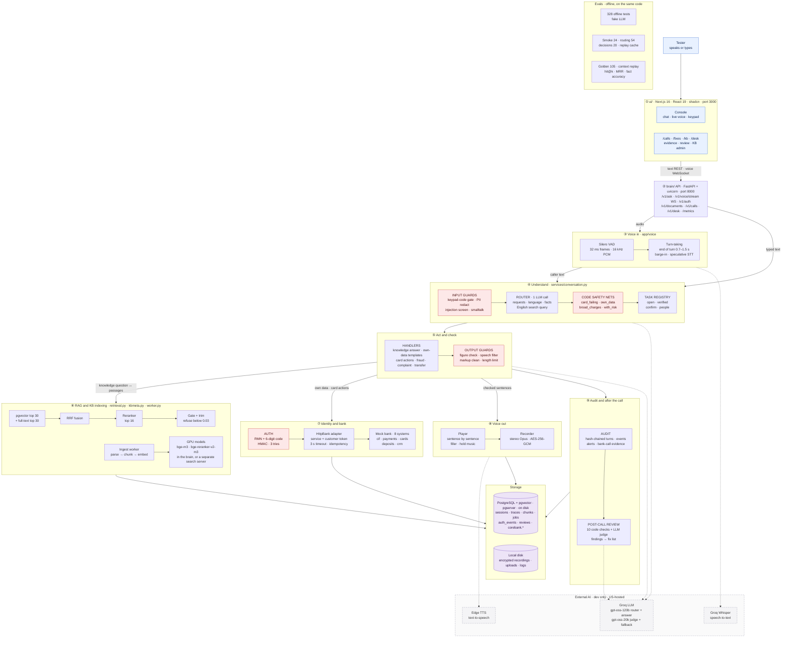

## 5. Deployed architecture (AWS Mumbai, proposed)

**What it is:** where everything would run in production.

**How to explain it:**
- **Callers** ring AU's Cisco contact centre, which streams the call audio to us. **AU staff** use the screens over HTTPS.
- Everything enters through **one load balancer with a WAF** (a web firewall) inside one AWS VPC in Mumbai, spread over 2 availability zones.
- An **ECS cluster** runs three services (counts from the Servers sheet, for 100 calls at once):
  - **au-ui:** the staff screens (static pages), 2 small containers so one can fail.
  - **au-brain:** the voice agent. 4 servers with 4 containers each; each container takes at most 9 calls (`MAX_LIVE_CALLS=9`) and then reports "full", so the load balancer sends new calls elsewhere. Diagram 9 shows where 9 comes from.
  - **au-search:** two GPU servers (one plus a spare) for the embed and rerank models.
- **Aurora PostgreSQL + pgvector** (a main and a standby that takes over in about 30 s) holds sessions, the KB and the audit trail.
- **Bedrock** (the LLM) and the other AWS services are reached over **private VPC endpoints**, so they stay off the internet.
- **Sarvam** (speech, India-hosted) is reached through a **NAT gateway** that only allows outbound traffic.
- **AU's bank APIs** are called with a **per-customer token**.

**Key point:** callers' data and the LLM both stay in India.

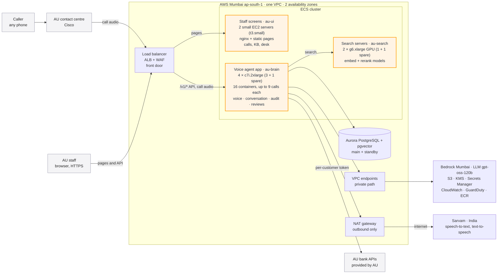

## 6. Early architecture and tech options (2 Nov research)

**What it is:** the first research view, from 2 Nov. It shows the pipeline at the top, then the tech options for each part, with prices.

**How to explain it:**
- **① How a call flows:** caller → telephony stream → noise filter + VAD → speech-to-text → **brain** (end of turn, language, state machine, redaction, LLM, response builder) → text-to-speech → back to the caller. Policy, guardrails, tools and observability are checked on every turn.
- **②–⑤ Options per part:** voice framework, hosted platforms, telephony, audio front-end, STT, LLM, knowledge base and TTS. A ✅ marks the choice at that time. There is also a cost estimate for one 3-minute call (about ₹10–14).
- **⑥–⑦ Run, store, measure** and **where AWS fits:** what to use, what is optional, and what not to use.
- **⑧ Alternative:** speech-to-speech models. They are fast, but harder to control and audit.

**Note:** this is the early plan. Later decisions changed some picks: we built our own pipeline instead of Pipecat, used fewer libraries, and chose a keypad OTP. Use diagrams 4 and 5 for what is actually built or proposed now. This one shows the options we compared.

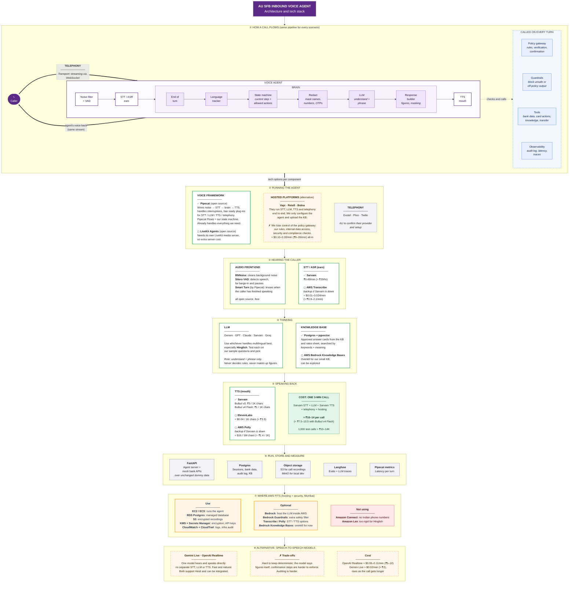

## 7. Timeline A: one caller turn, our container mostly waits

**What it is:** the Excalidraw board's chart A, as Mermaid. 12 seconds of one call, showing who is busy when: the caller, our app container, Sarvam (speech), the GPU search server and Bedrock (the LLM). Red bars are our container's CPU at work; they really last a few milliseconds and are drawn wider so they show up.

**How to explain it:**
- The caller speaks for about 3 s. All that time our container only **listens**: the voice detector checks every 32 ms of audio, which costs about 3% of a laptop core (about 4% on AWS).
- When the caller pauses, the audio goes to Sarvam in **one upload** and comes back as text.
- Then four tiny CPU bursts: end of speech, ask the router, ask for search, ask the answer model. The real work happens elsewhere: **Bedrock** (router about 0.6 s, then the answer), the **GPU** (search about 0.1 s) and **Sarvam** (the agent's voice, streamed).
- From about 4.7 s our container just **waits** while the reply is spoken. Its CPU is free for other calls (chart B).
- Listening never stops, even while the agent talks. That is how the agent notices when the caller interrupts.

**Key point:** a call needs very little of our own CPU, so one container can take several calls (chart B; diagram 9 gives the number: 9).

**Changed from the board (17 Nov 2026), to match the code:**

| On the board | Now | Why |
|---|---|---|
| "Speech-to-text, live" for the whole 3 s, then "Final text" | One "speech-to-text, one upload" bar after the caller pauses | Speech-to-text is not streamed yet: one request after a 0.3 s pause (streaming is pending-work B2.6) |
| Listening stops at 3.5 s | Listening runs the whole call | The voice detector runs on every 32 ms of audio for the whole call, also while the agent talks; that is how it hears an interruption |

```mermaid
gantt
    title A. One caller turn: our container mostly waits
    dateFormat x
    axisFormat %Ss
    tickInterval 1second

    section Caller (via AU's Cisco)
    Caller speaks                  : 0, 3000
    Hears the agent's reply        : 5600, 9300
    Thinks, then speaks again      : 9300, 12000

    section Our app container
    Listening - voice detector, about 3% of a core, all call : active, 0, 12000
    CPU - end of speech            : crit, 3500, 3600
    CPU - ask the router           : crit, 3800, 3900
    CPU - ask for search           : crit, 4400, 4500
    CPU - ask the answer model     : crit, 4580, 4680
    Waiting - CPU free for other calls : 4680, 9300
    CPU - next turn                : crit, 9300, 9400

    section Sarvam (speech)
    Speech-to-text, one upload after the caller pauses : 3300, 3800
    Text-to-speech, streamed to the caller : 5320, 9300

    section GPU server (search)
    Embed question + rerank 16 passages, about 0.1 s : 4440, 4560

    section Bedrock (LLM)
    Router                         : 3820, 4420
    Answer, first sentence         : 4580, 5330
    Answer keeps streaming         : 5320, 6200
```

## 8. Timeline B: while call A waits for the LLM, the container listens to B, C and D

**What it is:** the Excalidraw board's chart B, as Mermaid. Four calls (A–D) in one app container over the same 12 seconds, and the container's CPU at the bottom.

**How to explain it:**
- Each call is mostly "caller speaking" or "waiting for the LLM, GPU or Sarvam". Our container has almost nothing to do during either.
- Each call needs the CPU only in **short bursts**, and the bursts of different calls land at different moments. So while call A waits for the LLM, the container serves B, C and D.
- Under the bursts there is a **steady load**: every call's listening runs all the time, about 4% of a core per call on AWS.
- Bursts can also arrive together; then one waits a few milliseconds. That is why we keep a core under 60% busy, which gives **9 calls per container** (diagram 9).

**Changed from the board (17 Nov 2026):** added the always-on listening bar to "Container CPU". The board showed only the bursts, which made the CPU look idle between them.

```mermaid
gantt
    title B. While call A waits for the LLM, the container listens to B, C and D
    dateFormat x
    axisFormat %Ss
    tickInterval 1second

    section Call A
    Caller speaks                  : 0, 3000
    CPU burst                      : crit, 3500, 3600
    Waiting for LLM / GPU / Sarvam : 3850, 9250

    section Call B
    Caller speaks                  : 3000, 6000
    CPU burst                      : crit, 6500, 6600
    Waiting for LLM / GPU / Sarvam : 6850, 12000

    section Call C
    Waiting for LLM / GPU / Sarvam : 0, 3250
    Caller speaks                  : 6000, 9000
    CPU burst                      : crit, 9500, 9600

    section Call D
    Waiting for LLM / GPU / Sarvam : 850, 6250
    Caller speaks                  : 9000, 12000

    section Container CPU
    Always-on listening for every call, about 4% of a core each : active, 0, 12000
    D burst                        : crit, 500, 600
    A burst                        : crit, 3500, 3600
    B burst                        : crit, 6500, 6600
    C burst                        : crit, 9500, 9600
```

## 9. Sizing: from one call to the servers

**What it is:** the cost sheet's Servers tab as one chain, from one measured number to the number of servers. New 17 Nov 2026.

**How to read it:** green = measured, yellow = an assumption (worst case, until the load test), purple = the result we plan with.

**How to explain it:**
- **One call:** the voice detector costs 0.92 ms per 32 ms of audio = 2.9% of a laptop core. An AWS vCPU is slower (a hyper-thread), so × 1.5 = 4.3%. Everything else a call does is about 1%, doubled to be safe: 2.0%. **One call ≈ 6.3% of a core.**
- **One container** (one Python process) gets about one core for call work. We keep it under 60% busy, so 60% ÷ 6.3% = 9.5 → **9 calls**.
- **One server** (c7i.2xlarge, 8 vCPUs) runs 4 containers of 2 vCPUs = **36 calls**.
- **100 calls at once:** 100 ÷ 9 = 11.1 containers ÷ 4 = 2.78 servers, + 1 spare so one can fail → **4 servers, 16 containers**. They carry 144 calls (108 with one server down); at the busiest moment each container has about 6 calls.
- **The other servers:** search needs 0.3 of a GPU → 1 GPU server + 1 spare; the database is a main + standby; staff screens are 2 small containers.
- **400 calls at once,** same rule: 13 servers. If the load test measures 15 calls per container instead of 9, it is 8.

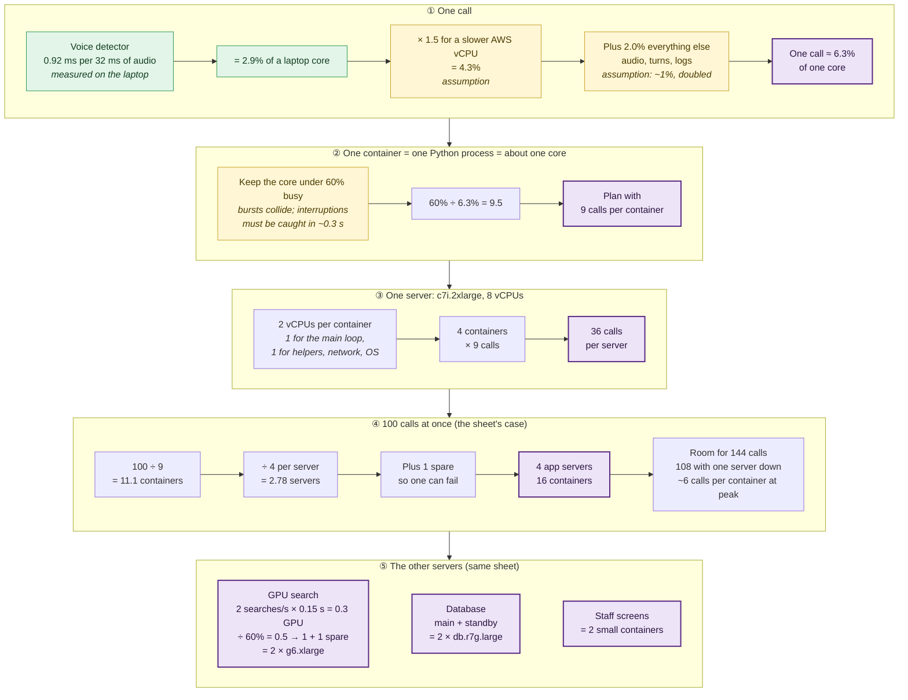

### Sizing in detail (16 Nov 2026, matches the cost sheet)

The numbers come from the **Servers** sheet of the cost workbook ("AU voice agent - AWS and Sarvam cost estimate (v2)", Google Sheets). This section explains them.

**The short version you can say out loud:**
> Each call uses about 6% of one AWS core, worst case: about 4% all the time for the voice detector, which also listens for interruptions, plus about 2% for everything else, such as the turn bursts. We keep a core under 60% busy, because bursts collide and interruptions must be caught fast. One process's call work gets at most about one core (one event loop, Python's GIL), so one container (one process, 2 vCPUs) carries **9 calls**. A server has 8 vCPUs, so 4 containers, 36 calls. For 100 calls at once that is 3 servers' worth of work plus 1 spare: **4 servers**. A load test on AWS replaces the assumptions.

**Where each call's CPU goes:**

| Part of a call | When | Share of one core | Status |
|---|---|---|---|
| Voice detector on every 32 ms chunk. This **is** the barge-in listening (it runs all call, also while the agent talks) | Whole call | 2.9% on the laptop (0.92 ms per 32 ms); × 1.5 on AWS = **4.3%** | Measured on the laptop; the 1.5 is a worst-case assumption |
| Everything else: audio in and out, recording, the turn bursts (speech upload, Bedrock, search, ~20–40 database queries, our checks, speech requests, audit), the barge-in check (one more speech-to-text call + a decision) | Mostly in short bursts | **2.0%** (about 1%, doubled to be safe) | Assumption |
| **One call** | | **6.3%** | |

An AWS vCPU is one hyper-thread, half of a physical core (a c7i.2xlarge has 8 vCPUs = 4 cores), and slower than a laptop core. Hence the × 1.5.

**From that to servers** (100 calls at once, the sheet's case):

| Step | Working | Result |
|---|---|---|
| One call | 4.3% + 2.0% | 6.3% of a core |
| Most of a core we let calls use | Bursts collide; interruptions must be caught within ~0.3 s; the after-call review also runs here | 60% |
| Calls per container | 60% ÷ 6.3% = 9.5, rounded down | **9** |
| Containers needed | 100 ÷ 9 | 11.1 |
| Containers per server | 8 vCPUs ÷ 2 vCPUs per container (one for the main loop, one for helper threads, network and the OS) | 4 (36 calls) |
| Servers doing the work | 11.1 ÷ 4 | 2.78 |
| Plus a spare, so one can fail | 2.78 + 1 = 3.78, rounded up | **4 servers**, 16 containers |
| At the busiest moment | 100 ÷ 16 | 6.3 calls each (limit 9); 108 calls still fit with one server down |
| Same rule for 400 calls | 400 ÷ 9 = 44.4 containers ÷ 4 = 11.1 servers + 1 spare | **13 servers** |

**What changed from the first version, and why:**

| First version | Problem | Now |
|---|---|---|
| "~4% per call, ~25 calls fill one vCPU" | "Fill" means 100% busy, and waits then grow without limit | Keep a core under 60% |
| "2 vCPUs per container, ~36 calls each" | 36 × 4% = 144% of one core, but a container runs **one** Python process and the detector is on its single main loop; the second vCPU only helps helper threads | 9 calls per container; 36 per **server** |
| "+30% spare so a server can fail" | Mixed up two reserves | Room for bursts (60%) **and** one spare server |
| Laptop number used for AWS | An AWS vCPU is a hyper-thread | × 1.5 |
| Listening stopped while the agent spoke | The code listens all call (barge-in) | Drawn all call; it was always inside the 2.9% |
| No outside check | LiveKit plans 10–25 calls per 4-core server; Pipecat 0.5 vCPU per call | 9 calls per 2 vCPUs is in that range |

**Ways to fit more calls per server later, only if the load test says so:** 1-vCPU containers (one process per vCPU); the detector in background threads (Silero releases Python's lock, so several cores work at once); a cheap loudness gate that skips the detector on near-silent chunks (must not miss quiet speech); Sarvam's own speech signals once we stream to Sarvam. A Redis or SQS "watchman" does **not** help: it can't recognise speech, so something still runs the detector, and passing 12,500 audio chunks a second (400 calls) through a queue costs more CPU and adds delay (PROJECT-GUIDE §26.6).

**Not verified:** only the 0.92 ms is measured. The × 1.5 and the 2% are worst-case assumptions until the load test with silent, talking and interrupting calls (PROJECT-GUIDE §26.6). After it, the measured number goes into the sheet's yellow "calls per container we plan with" cell.

## 10. Where the money goes each month

**What it is:** the cost sheet's total, split by item. New 17 Nov 2026. Values are read from the Cost tab of "AU voice agent - AWS and Sarvam cost estimate (v2)" on 17 Nov: 100 calls at once, about 3,75,000 calls a month of about 4 minutes.

**Total: ₹28,53,051 a month, ₹7.61 a call, ₹1.90 a minute.**

| Who we pay | ₹ a month | Share |
|---|---|---|
| Sarvam (speech-to-text and the agent's voice) | ₹19,81,875 | 69.5% |
| AWS Bedrock (the LLM) | ₹4,38,722 | 15.4% |
| AWS servers and services | ₹4,32,455 | 15.2% |

**How to explain it:**
- **The voice is the big cost, not the servers.** Text-to-speech alone is almost half of the bill (47.9%), and speech-to-text another 21.6%.
- **The LLM is about 15%.** Bedrock charges per token: most is the text it reads (11.3%), not what it writes (4.0%).
- **All the servers together are under 10%** (9.8%: GPU search 4.7%, app 3.5%, database 1.5%, staff screens 0.1%). Storage, traffic, network and security add 5.4%. So diagram 9's 4 app servers cost only ₹99,018 a month.
- **The biggest saving to check is speech-to-text.** The estimate counts the whole call, but the code only sends the caller's speech. If that is about 40% of the call, it saves about ₹3.69 lakh a month (the Choices tab).

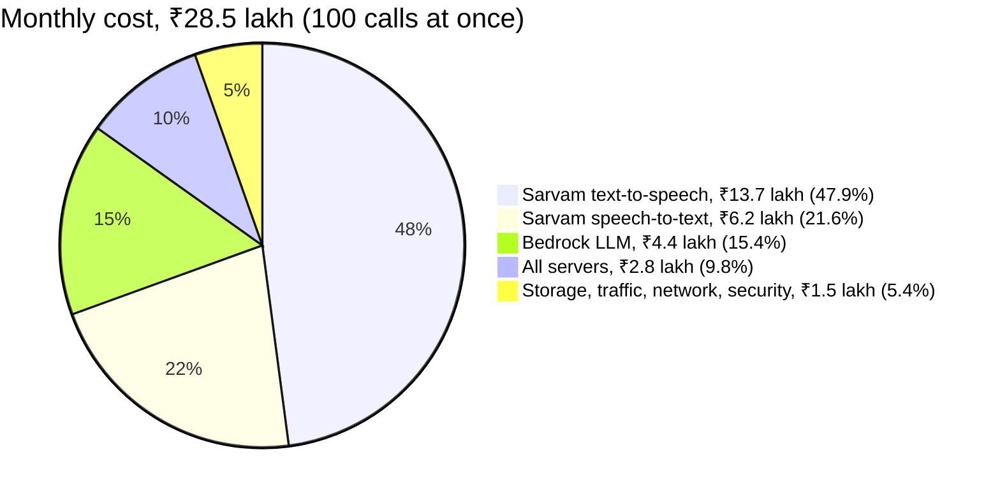

## 11. Solution architecture: the parts of the agent

**What it is:** the agent's building blocks in one picture, in the same style as a vendor's solution slide. New 18 Nov 2026. It shows the parts, not the servers; diagram 12 shows where they run.

**How to explain it:**
- **A call comes in.** Today it comes from the test console in a browser. Later it will come from AU's Cisco contact centre; how Cisco hands over the audio is still to be agreed.
- **The rule for the left side (changed 19 Nov 2026):** the **call orchestrator decides when**; the two speech layers only **sense** (audio → signals and text) and **produce** (text → audio).
- **The call orchestrator** runs one live call (`voice/session.py`, `voice/turntaking.py`, `voice/player.py`, `voice/hold.py`):
  - **end-of-turn decision:** has the caller finished? Silence length plus "does it sound unfinished?" ("…and", "aur");
  - **barge-in decision:** is sound during our reply noise, echo, a "hmm", or a real interruption?
  - **playback:** paces the reply audio and stops it the moment the caller interrupts;
  - hold messages, and at most 9 calls per container.
- **Speech-in layer (senses):**
  - Speech activity detection (Silero) runs **inside our app**, every 32 ms. It must stay local: barge-in needs its answer within milliseconds, while our own reply is playing.
  - Speech-to-text is a Sarvam client. Sarvam returns the text and the language.
- **Bot application:**
  - Guardrails mask personal data and check the request is in scope.
  - The LLM only turns the words into a short JSON summary.
  - **Code decides** the rest: routing, keypad verification, permissions, and which bank call or journey runs.
  - Product answers come from the knowledge base (search, then rerank). Personal answers come from the bank systems.
  - The response generator uses fixed templates, or LLM phrasing, and a figure check blocks any number not in the source.
- **Speech-out layer (produces):** it writes numbers the way people say them (₹, dates, account digits), fixes the pronunciation of names and terms, and plays common phrases from a cache. Everything else goes to Sarvam for speech. The audio goes back to the orchestrator's playback.
- **Network boundaries:**
  - The app, the staff screens and the database sit in **private subnets of a VPC**. Nothing on the internet can reach them directly.
  - Bedrock, SageMaker, S3, CloudWatch, Secrets Manager and ECR are AWS services **outside the VPC**, reached privately through VPC endpoints (no internet).
  - **Sarvam is outside AWS.** Both speech clients reach it over HTTPS with an API key, out through the **NAT gateway**. This is the only call that leaves AWS.
- **Around it:**
  - the staff screens: console, KB, calls, desk and fixes;
  - the database, the recordings store, logs and alerts, secrets, and the image registry.

**Not used, on purpose:** no Redis and no separate microservices. One app process holds all the layers, which is simpler to run and to audit.

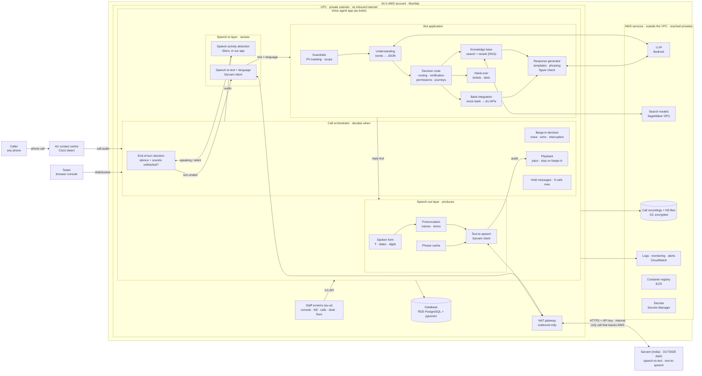

## 12. AWS deployment (pilot)

**What it is:** where each part runs for the pilot in AWS Mumbai. New 18 Nov 2026. The bigger production layout (ECS, many copies) is diagram 5. Steps are in `deploy/aws-pilot-guide.md`.

**How to explain it:**
- **Everything comes in through one HTTPS load balancer.** It sends pages to the UI container, and the API and live calls to the brain container. Both containers run with Docker on **one EC2 server**.
- **The brain is the only part that talks to the other services.** It uses the server's IAM role, so no keys are stored.
  - **RDS PostgreSQL:** one database, two schemas.
  - **SageMaker:** the search models on a GPU.
  - **Bedrock:** the LLM.
  - **S3:** KB files and encrypted recordings.
  - **Secrets Manager:** the database address, the Sarvam key and the recording key.
- **AWS services are reached over private VPC endpoints.** Sarvam is the only call that leaves AWS, through the NAT gateway.
- **Images:** two Dockerfiles make three images (`au-brain` without models, `au-ui`, and `au-search` with the models, for SageMaker).

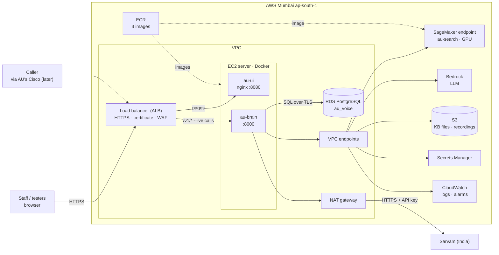

## 13. Data flow diagram, level 0 (context)

**What it is:** the whole system as one box, with everyone who sends it data or gets data from it. New 18 Nov 2026. Each arrow names the data.

**How to explain it:**
- **The caller** sends their voice and keypad digits and hears replies. The keypad code is typed, never spoken.
- **AU staff** upload KB documents and read calls, tickets and hand-overs.
- **Sarvam** gets the caller's speech and the reply text. **Bedrock** gets **masked** text only: no names, numbers or codes.
- **AU's bank systems** (today the mock bank) return the verified caller's own data and carry out confirmed card actions.
- **The SMS gateway** (later) sends the one-time code to the caller's registered mobile. Today the code is shown in the test console.

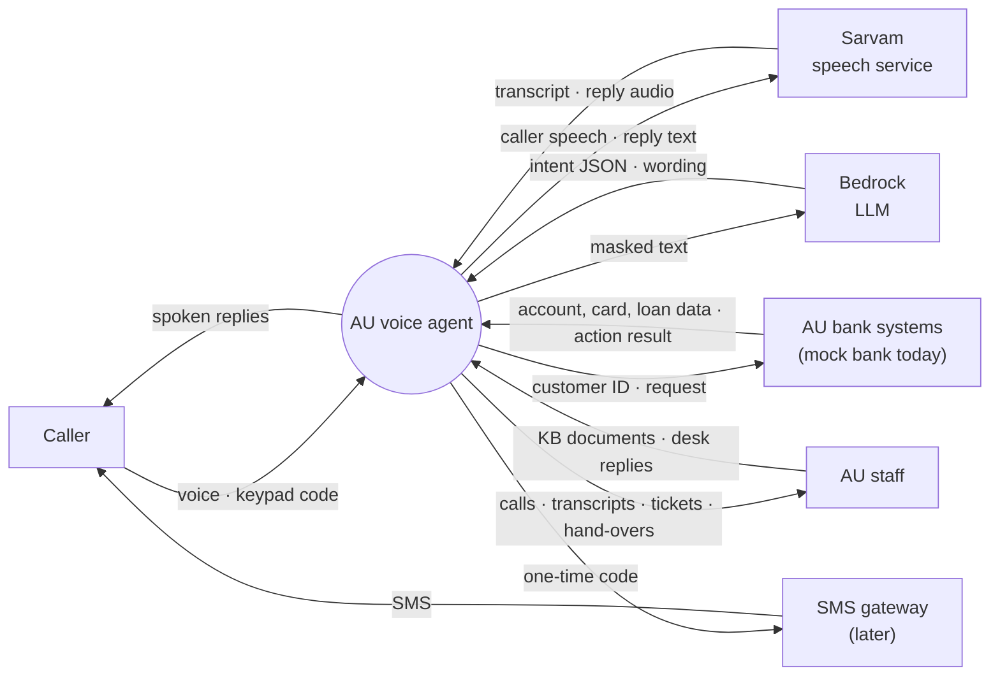

## 14. Data flow diagram, level 1 (inside the system)

**What it is:** the main steps inside the agent, where data is stored, and where it crosses a trust boundary (the dashed boxes). New 18 Nov 2026. Circles are processes, cylinders are data stores, rectangles are outside parties.

**How to explain it:**
- **Process 1** receives the call. **Process 2** turns speech into text with Sarvam.
- **Process 3** checks the keypad code. Digits go straight from the keypad to the check: **never through speech-to-text, the LLM or the logs.**
- **Process 4** masks personal data, asks Bedrock for the intent, then **code** decides what is allowed.
- **Processes 5 and 6** fetch the caller's own bank data (only once verified; card actions only after a clear "yes") or search the KB.
- **Process 7** builds the reply and speaks it with Sarvam.
- **Process 8** writes the audit trail:
  - masked transcripts and events go to the database;
  - recordings are encrypted by the app before they go to S3;
  - logs carry no personal data.
- **Process 9** is staff adding KB documents.

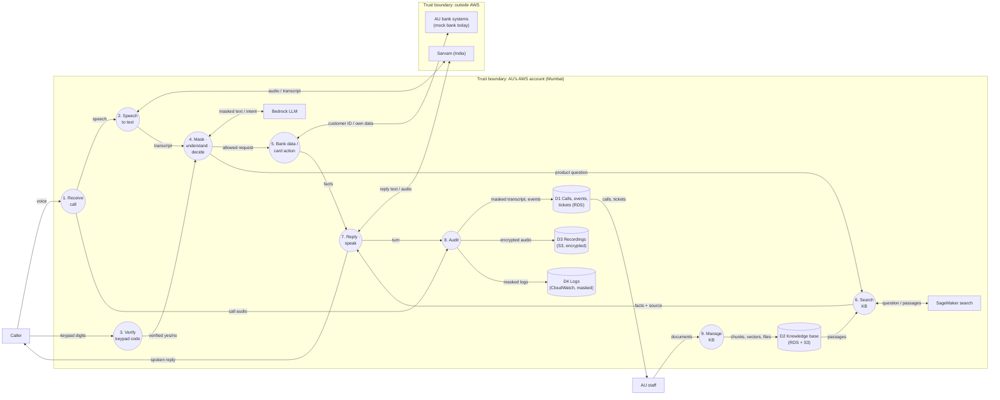

## 15. Deploy and update (CI/CD)

**What it is:** how a code change reaches the server. New 18 Nov 2026. Details in `deploy/aws-pilot-guide.md` §4–5.

**How to explain it:**
- **Every pull request runs the offline tests and the UI build.** A failure blocks the merge.
- **A merge to `main` builds the images.** They are tagged with the git commit and pushed to ECR.
- **The server is updated through AWS Systems Manager** (no SSH). It pulls the new images, restarts the containers and checks `/health/ready`. If the check fails, it goes back to the previous version.
- **Production waits for a person to approve.**
- **Search changes are rare and done separately.** SageMaker swaps to the new version with no downtime.

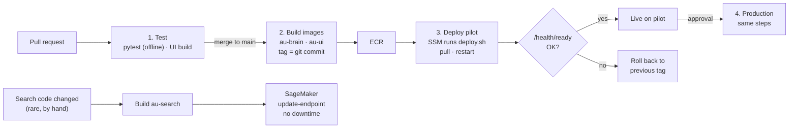

## 16. Sequence: a verified card block

**What it is:** one controlled action from start to end, in the order the checks happen. New 18 Nov 2026. In draw.io: Arrange → Insert → Advanced → Mermaid, then paste this code.

**How to explain it:**
- **Before anything else:** the LLM sees masked text only and returns the intent. Code then decides that a card action needs a verified caller.
- **Verification:** the code is typed on the keypad. It never goes through speech-to-text, the LLM or the logs.
- **Confirmation:** the agent asks for the block type, then gets an explicit "yes" before anything changes.
- **The block itself:** the bank call carries an idempotency key, so a retry can't block twice.
- **Audit:** the action, the events, the masked transcript and the encrypted recording are all stored.

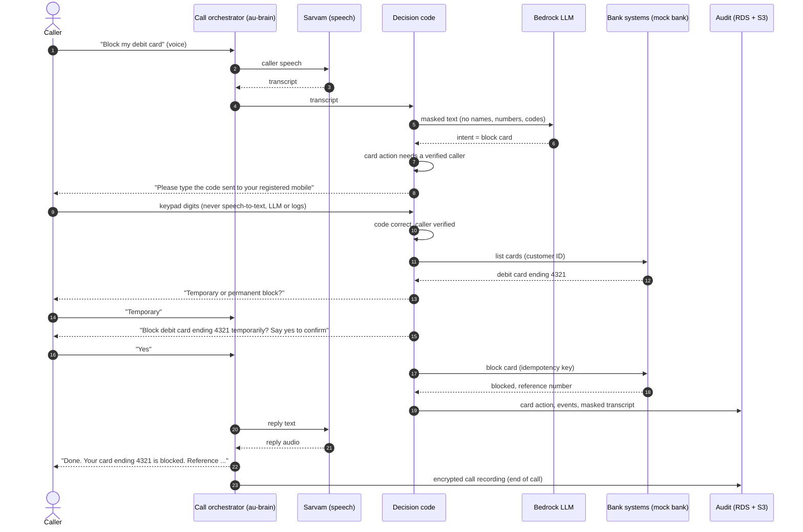

## draw.io versions (for slides and reviews)

The presentation versions, in the style of a vendor solution slide (coloured boxes, layer groups, database cylinders, official AWS icons), are in `docs/diagrams/drawio/`. Open them in the draw.io desktop app or the VS Code "Draw.io Integration" extension. Export to PNG or PDF from there (File → Export as). The Mermaid diagrams above stay the quick-to-update version.

| File | Shows | Mermaid twin |
|---|---|---|
| `01-solution-architecture.drawio` | The agent's layers in a U-shape (speech in → bot → speech out). The orchestrator holds the decisions (end of turn, barge-in, playback); the speech layers only sense and produce. Network boundaries: VPC, AWS services reached privately, Sarvam outside AWS through the NAT gateway. Around them the staff console, database, logs, storage, secrets and registry | §11 |
| `02-aws-deployment.drawio` | AWS icons: VPC, subnets, ALB + WAF, EC2 with both containers, RDS, SageMaker, Bedrock, S3, CloudWatch, SNS, KMS, ECR, SSM, CloudTrail, GuardDuty, NAT to Sarvam | §12 |
| `03-dfd-level-0.drawio` | Data flow diagram, context | §13 |
| `04-dfd-level-1.drawio` | Data flow diagram: 9 processes, 5 data stores, trust boundaries | §14 |
| `05-cicd-pipeline.drawio` | Test → build → ECR → deploy → health check / rollback → approval → production; search updates; database changes | §15 |
| `06-logging-monitoring-audit.drawio` | Every log source and where it is stored (CloudWatch Logs, S3 archive, RDS audit tables, S3 recordings), alarms to SNS, who reads what | — |
| `07-database-layout.drawio` | RDS → database `au_voice` → schemas `public` and `corebank` with their table groups, the logins, the link to S3 | — |
| Sequence (above, §16) | A verified card block | §16 |

## Appendix: earlier versions

Kept for reference. Diagrams 7 and 8 above are the Excalidraw board's charts (chosen 17 Nov 2026). These 16 Nov versions add more detail: the caller interrupting the agent, and two calls' bursts arriving together.

### A1. Earlier Timeline A (16 Nov 2026)

**What it is:** a 12-second slice of one call, showing who is busy when. Red bars are our app's CPU at work. They really last a few milliseconds and are drawn wider so they show up. (Redrawn 16 Nov 2026: the first version stopped listening while the agent spoke and ignored barge-in.)

**How to explain it:**
- **Listening never stops.** For the whole call, including while the agent is speaking, the voice detector checks every 32 ms of the caller's audio. That is how we notice an interruption. Each check takes about 0.9 ms, then the CPU is free for about 31 ms. So "always listening" costs about 3% of a core, not 100%.
- While the agent speaks, our app also sends its audio in 20 ms chunks (a small extra cost).
- When the caller stops, we wait 300 ms, then upload the audio to Sarvam (speech-to-text is **not live yet**: it is one upload per sentence until the streaming work, pending-work B2.6).
- The turn's CPU bursts follow (router, search, answer, speech requests). The real work happens elsewhere: **Bedrock**, the **GPU** search server and **Sarvam**.
- **Barge-in at about 7 s:** the caller says "wait...", pauses, then asks "what is the senior citizen rate?". After 0.35 s of speech the agent's voice is turned down (it keeps talking, quieter). When the caller pauses for 0.3 s (or after 1.5 s of speech if they don't pause) the snippet goes to speech-to-text, and code decides it is a real interruption (not noise, echo or "haan"). The agent stops at about 8 s and the rest of the question becomes the next turn. That is a few tiny bursts and one more Sarvam request.

**Key point:** a call needs little of our own CPU, but some of it is needed **all the time** and some of it must happen **within about 0.3 s**. So we never plan to run a core near full (A2 below).

```mermaid
gantt
    title A. One turn with an interruption - listening never stops
    dateFormat x
    axisFormat %Ss
    tickInterval 1second

    section Caller (via AU's Cisco)
    Asks a question                      : 0, 3000
    Hears the reply                      : 5300, 7000
    Says wait, then pauses               : 7000, 7400
    Asks - senior citizen rate?          : 8100, 9300
    Hears the new reply                  : 11300, 12000

    section Our app - always on
    Voice detector on every 32 ms chunk, about 3% of a core, all call : active, 0, 12000
    Sends agent audio in 20 ms chunks, quieter from 7.35 s : 5300, 8000
    Sends agent audio again              : 11300, 12000

    section Our app - CPU bursts
    Pause seen, upload audio to Sarvam   : crit, 3300, 3350
    End of turn, ask the router          : crit, 3600, 3650
    Ask for search                       : crit, 4250, 4300
    Ask the answer model                 : crit, 4420, 4470
    Send sentences to text-to-speech     : crit, 5100, 5130
    Possible interruption, duck the voice : crit, 7350, 7370
    Caller paused, send the snippet      : crit, 7700, 7720
    Real interruption, stop the agent    : crit, 8000, 8030
    Next turn bursts                     : crit, 9600, 9750

    section Sarvam (speech)
    Speech-to-text, one upload           : 3350, 3600
    Text-to-speech, streamed             : 5130, 6900
    Speech-to-text on the snippet        : 7720, 8000
    Speech-to-text, next turn            : 9600, 9850
    Text-to-speech, new reply            : 11100, 12000

    section GPU server (search)
    Embed question + rerank, about 0.1 s : 4300, 4420

    section Bedrock (LLM)
    Router                               : 3650, 4250
    Answer streams                       : 4470, 6200
    Next turn router and answer          : 9850, 11100
```

### A2. Earlier Timeline B (16 Nov 2026)

**What it is:** four of the up to 9 calls that share one app container (one Python process), over the same 12 seconds.

**How to explain it:**
- **One process's call work gets at most about one core**: the voice detector and the turn logic run on its single main loop, and Python's GIL lets only one thread run Python code at a time. (The process has many other threads, and is not tied to a particular vCPU; PROJECT-GUIDE §26.11.) So the bottom section is one core.
- Every call's listening runs all the time, so the core always carries a steady band (9 calls × about 5.5% ≈ 50%: the detector's 4.3% plus moving audio in and out, worst case on AWS. With the turn bursts added, the cost sheet's 6.3% per call gives about 57% on average).
- On top of that come the bursts. With 9 calls, a turn ends about every 1.3 seconds, so **bursts sometimes collide**: here B's burst arrives while A's is running and waits. A turn's CPU (40–120 ms, estimate) comes in many small pieces of a few milliseconds spread over about 2 seconds, so a real collision usually costs a few milliseconds; the bars are drawn wider so they show up. Rare, short waits are fine. If the core ran near 100%, waits would grow quickly and interruptions would be noticed late. That is why we keep each process **under about 60% busy**.
- Call D's interruption check is tiny but urgent; it gets through because the core has room.

Mermaid can't draw a 50% band, so the label carries the meaning.

```mermaid
gantt
    title B. One process, one core - calls share it and bursts sometimes collide
    dateFormat x
    axisFormat %Ss
    tickInterval 1second

    section Process CPU (one core)
    Always-on listening for all 9 calls, about 50% of the core : active, 0, 12000
    A burst                              : crit, 3500, 3600
    B burst, arrived with A, waits a little : crit, 3600, 3700
    C burst                              : crit, 6500, 6600
    D interruption check                 : crit, 9200, 9230

    section Call A
    Caller speaks                        : 0, 3000
    Waiting for Sarvam, LLM, GPU         : 3600, 8000
    Hears the reply                      : 5600, 9500

    section Call B
    Caller speaks                        : 500, 3050
    Waiting, started a little late       : 3700, 8200

    section Call C
    Caller speaks                        : 3500, 6000
    Waiting for Sarvam, LLM, GPU         : 6600, 11000

    section Call D
    Hears the agent                      : 6000, 8800
    Interrupts                           : 8800, 9500
```
