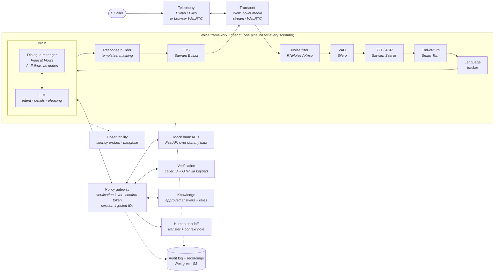
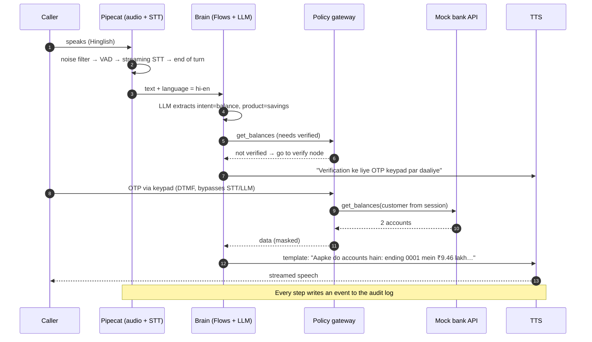

# AU SFB Inbound Voice Agent: Tech Stack and Architecture (v0.1, research stage)

Builds on `scenario-map.md`. Prices are list prices found in November 2026, mostly from vendor pages and aggregators. They move often, so verify them before budgeting. Conversions assume **₹88 = $1**.

---

## 0. Is the architecture different per scenario?

**No.** Every call goes through **one pipeline**: telephone → ears (speech-to-text) → brain → mouth (text-to-speech) → telephone.

The scenarios (general info, personal info, actions, complaints, transfer) differ only *inside the brain*:
- which **conversation state** the call is in (the A–E flows from the diagram),
- which **tools** (bank APIs) that state may call,
- what **verification level** those tools need.

Adding a scenario means adding a flow node and a tool, not new infrastructure.

**On the terms:** ASR (automatic speech recognition) and STT (speech-to-text) are the same component. The order is **STT/ASR → brain (LLM + state machine) → TTS**.

---

## 1. The components (what we need, end to end)

| # | Component | Job in one line |
|---|---|---|
| 1 | **Telephony / caller channel** | Gives us a phone number and streams the call audio to our server (or a browser call for the demo) |
| 2 | **Transport** | Carries the audio both ways in real time (WebSocket media stream or WebRTC) |
| 3 | **Voice framework (orchestrator)** | The pipeline that wires every piece together, frame by frame, and handles interruptions |
| 4 | **Audio front-end** | Noise removal, voice activity detection (VAD), end-of-turn detection |
| 5 | **STT / ASR** | Turns caller speech into text, in Hindi, English or Hinglish |
| 6 | **Language tracker** | Decides which language to reply in; keeps it steady ("sticky") across short replies |
| 7 | **Dialogue manager (state machine)** | Holds the conversation state and runs the A–E flows deterministically |
| 8 | **LLM** | Understands intent and details, and phrases replies naturally. It does **not** decide policy and does **not** produce numbers |
| 9 | **Policy gateway** | Every tool call passes through it: checks verification level, needs a confirmation token for actions, injects the customer ID from the session |
| 10 | **Tools / mock bank APIs** | Accounts, transactions, cards, card controls and block, built over the dummy Excel and clearly labelled simulated |
| 11 | **Verification service** | Simulated caller-ID match + OTP entered on the **keypad (DTMF)**, so secrets never pass through STT, the LLM or logs |
| 12 | **Knowledge layer** | Approved answers from the KB and a cleaned rates table, with small hybrid search |
| 13 | **Response builder** | Fills figures into templates in the caller's language (amounts in lakh, masked last 4) |
| 14 | **TTS** | Turns the reply text into natural Indian-language speech, streamed |
| 15 | **Human handoff** | Warm transfer with a context note (phone transfer, or an agent console in the demo) |
| 16 | **Audit and storage** | Append-only, hash-chained event log per call, plus masked transcripts and recordings |
| 17 | **Observability and evals** | Per-turn latency, LLM traces, a test-call harness for the sample questions |
| 18 | **Hosting** | India region (Mumbai) for low latency and data-residency comfort |
| 19 | **PII redaction** | Masks names, account and card numbers and OTPs before any text reaches the LLM. The bank tools still get the real values through the policy gateway |

**Backup providers:** if Sarvam STT or TTS is unavailable, the pipeline switches to AWS Transcribe or AWS Polly. If the LLM is unavailable, the agent drops to a minimal scripted mode or transfers.

---

## 2. Architecture flow (runtime)

### What happens on one turn (e.g. "Mera balance kitna hai?")

---

## 3. Every technology in brief: what it is, how it works, where it fits, why

### 3.1 Voice frameworks (the orchestrator)

**Pipecat** *(open source, BSD-2, Python, backed by Daily)*
- **What:** a framework for real-time voice agents.
- **How:** everything is a *frame* (audio chunk, text, interruption signal) flowing through a chain of *processors* (VAD → STT → LLM → TTS → output).
- **What it takes care of for you:** audio buffering, streaming between services, barge-in (cancel speech when the caller talks), plug-in services for 50+ vendors (including Sarvam), and telephony serializers for Twilio, Plivo, Exotel and Telnyx that convert 8 kHz phone audio.
- **Where:** component 3, the backbone.
- **Why:** Python; pipeline-first, so every stage is visible and swappable; Sarvam has an official Pipecat guide; and it has Pipecat Flows (below).

**Pipecat Flows** *(Pipecat add-on)*
- **What:** a state-machine layer for structured conversations.
- **How:** you define *nodes* (conversation states), each with its own instructions and *only* the functions allowed in that state. Functions move the call to the next node. A shared state dictionary carries data such as verified status and the selected card across nodes.
- **What it takes care of for you:** turning free-form LLM chat into controlled, testable journeys.
- **Where:** component 7. Our A–E diagram flows map almost 1:1 onto Flows nodes.
- **Why:** gives us the determinism banking needs. The LLM can't call `block_card` unless the call is in the confirmation node.

**LiveKit Agents** *(open source, Apache-2.0)*
- **What:** an agent framework tied to LiveKit's WebRTC media server.
- **How:** event-driven sessions in "rooms", with automatic state sync to clients. It also has SIP telephony.
- **Where:** an alternative to Pipecat.
- **Trade-off:** stronger real-time media infrastructure and a bigger community, but you also run (or pay for) a LiveKit server. Its structured-flow tooling is less direct than Pipecat Flows, and I found no official Hindi turn detector.
- **Verdict:** a good option. Pipecat fits our "state machine + Sarvam" needs a little better.

**Managed platforms: Vapi, Retell, Bolna** *(paid SaaS)*
- **What:** hosted voice-agent platforms. You configure an agent; they run STT, LLM, TTS and telephony.
- **What they take care of:** almost everything, so you get to a demo fast.
- **Why not for us:** we lose control over the policy gateway, audit trail and deterministic flows, which are 15% of the score and the core of "trust". All-in cost is about $0.10–0.30/min. Bolna is India-focused but has no public per-minute price.

### 3.2 Telephony and transport

- **Exotel** *(paid, Indian CPaaS)*: Indian numbers, KYC/DLT compliance, and media streaming over WebSocket to our server. Inbound about ₹0.30–0.50/min (vendor figure). **Where:** the phone number for the demo. **Why:** India-native, cheapest inbound, and Pipecat supports it.
- **Plivo** *(paid)*: similar. It now positions itself as voice-AI-first with self-serve India numbers and audio streaming. About ₹0.4–0.7/min (sources conflict).
- **Twilio** *(paid)*: the most mature bidirectional media-stream API, but pricier in India and its Indian number rules are stricter.
- **WebRTC in the browser** (Pipecat SmallWebRTC or Daily): no phone number needed and better audio (Opus codec) than an 8 kHz phone line. **Where:** the live demo and evals. **Why:** free, and it removes the telephony risk on demo day. Show the phone path as a bonus.
- **WebSocket media stream:** how phone platforms send live call audio (8 kHz μ-law) to our server and receive audio back.

### 3.3 Audio front-end

- **RNNoise** *(open source)*: a small neural noise suppressor that cleans each audio frame before STT. Free; useful for the "noisy call" bonus. **Krisp** *(paid)* is stronger.
- **Silero VAD** *(open source)*: detects whether a frame contains speech. It triggers STT, measures pauses, and lets barge-in fire the moment the caller starts talking.
- **Smart Turn v3** *(open source, Pipecat)*: an audio model that predicts "has the caller *finished* their thought?" from tone and rhythm, not just silence. **Why:** endpointing is the hidden source of latency. A fixed silence wait adds 1–3 s, while Smart Turn lets us reply in about 200–300 ms. Pipecat docs say it covers 23 languages, and community Hinglish fine-tunes exist, but **Hindi quality needs verifying**. The fallback is the STT's own endpointing.
- **Barge-in:** a framework feature, not a product. When VAD hears the caller during agent speech, it cancels the LLM and TTS and flushes queued audio.

### 3.4 STT / ASR (ears)

| Option | What / how | Hindi, Hinglish | Price (list) | Verdict |
|---|---|---|---|---|
| **Sarvam Saaras / Saarika** (paid, Indian) | Streaming STT trained on Indian speech; 22 Indian languages + English; code-mix and translate modes | Strongest fit, built for Indic and Hinglish | **₹0.49/min** (₹29/hr) | **Primary** |
| **Soniox v5 real-time** (paid) | One multilingual model with automatic mid-sentence language switching | Claims strong Hindi results (vendor benchmarks) | **~$0.12/hr** (~₹0.18/min) | **Worth benchmarking**: very cheap |
| **Deepgram Nova-3 Multilingual** (paid) | Very fast streaming STT; `language=multi` for code-switching | Good English; Hindi weaker than Indic specialists | ~$0.0058–0.0092/min (~₹0.5–0.8) | Fallback; best for English speed |
| **Amazon Transcribe** (AWS) | Managed streaming STT, hi-IN supported since 2022 | Hinglish code-switching unconfirmed | ~$0.01–0.024/min (sources conflict) | AWS-native option, needs testing |
| **AI4Bharat IndicConformer** (open source) | 600M multilingual Conformer model, all 22 languages, CTC/RNNT decoding | Good Hindi accuracy (~9–10% WER, community figure) | Free + GPU hosting | Self-host or offline path; no streaming wrapper out of the box |
| **Whisper large-v3 / turbo** (open source) | Batch speech model, auto language detection | Hindi OK; Hinglish and short noisy clips weak | Free / cheap on Groq | Not streaming, so not preferred |

### 3.5 The brain

- **LLM (component 8):** used for **understanding** (intent, details, language, as structured JSON), for **phrasing** non-numeric replies, and for following the current Flows node's instructions. It's also guarded: it never sees OTPs, never invents figures, and can only call tools exposed in the current node.

| LLM option | What | Strengths for us | Price (per 1M tokens, list) |
|---|---|---|---|
| **Gemini Flash** (Google, latest 3.x) | Fast, multilingual hosted model | Low time-to-first-token, strong Hindi, cheap | ~$0.75 in / $3.75 out (introductory to Dec 2026) |
| **GPT mini class** (OpenAI) | Fast mid-tier | Reliable function calling | ~$0.40 / $1.60 (GPT-4.1 mini; newer minis vary) |
| **Claude Haiku class** (Anthropic; also on **AWS Bedrock**) | Fast, steady latency | Consistent instruction following and refusals; available inside AWS | Haiku 4.5: $1 / $5; check the newest Haiku |
| **Sarvam 105B** (Indian) | Indian-language LLM | Native Indic, in-country | ₹15 in / ₹60 out (~$0.17 / $0.68) |
| **Groq-hosted open models** (Llama, Qwen, GPT-OSS) | Open weights on very fast chips | Lowest latency, cheapest | ~$0.05–0.79 |

**Approach:** shortlist 2 (for example Gemini Flash and a Claude Haiku), then pick by **our own Hinglish benchmark** built from the sample questions, scoring intent accuracy, JSON validity and time-to-first-token.

- **Pipecat Flows:** covered above (the dialogue manager).
- **Policy gateway** *(our own code, a small Python module)*: a wrapper around every tool. It checks the verification level in session state, requires a single-use confirmation token (action + target card + short expiry) for writes, adds an idempotency key so retries can't double-block, and writes audit events. **Why:** the brief says the AI layer must not be able to bypass controls. This is where that guarantee lives, in code rather than in prompts.
- **Response builder** *(our own code)*: templates per intent and language. It speaks ₹946213 as "nau lakh chhiyaalis hazaar…", masks numbers to the last 4, and formats dates naturally. **Why:** figures are guaranteed correct and identical in the audit log.

### 3.6 Knowledge

- **Approved answer cards:** we convert the KB docs and rates PDF into short, reviewed facts (one fact or table row each). The rates PDF must be transcribed **by hand** because its text extraction is scrambled.
- **Hybrid search:** keyword (BM25) + multilingual embeddings (for example bge-m3 or multilingual-e5, open source) + a light reranker. **How:** the caller's question finds the 2–3 relevant cards, which are given to the LLM as quoted data. **Why:** the KB is small (~120 KB), so this is enough; Hindi questions still match English cards. **Where it lives:** Postgres with the pgvector extension, or in memory.
- **Alternatives:** AWS Bedrock Knowledge Bases (managed version of the same pipeline; overkill here), LlamaIndex / LangChain (libraries that do the same; not needed at this size).

### 3.7 TTS (mouth)

| Option | What / how | Hindi, Hinglish voice | Price (list) | Verdict |
|---|---|---|---|---|
| **Sarvam Bulbul v3** (paid) | Indian-voice TTS, streaming over WebSocket, handles code-mixed text | Most natural Indian prosody | **₹3 per 1K chars** | **Primary (quality)** |
| **Sarvam Bulbul v4 Flash** | Lower-latency, cheaper tier | Same family | **₹1 per 1K chars** | **A/B test against v3 for latency** |
| **ElevenLabs Flash v2.5** | Very low-latency multilingual TTS | Good Hindi, Western-tuned voices | ~$0.04 per 1K chars (~₹3.5) | Premium alternative |
| **Cartesia Sonic** | Real-time-focused TTS | Hindi supported | ~$0.03–0.05 per 1K chars | Alternative |
| **Azure Neural TTS** | Managed TTS, Hindi neural voices | Solid, slightly formal | ~$15–16 per 1M chars (~₹1.4 per 1K) | Cheap and reliable fallback |
| **Google Chirp 3 HD** | Managed high-quality voices | Hindi supported | ~$30 per 1M chars | Alternative |
| **Amazon Polly** (AWS) | Managed TTS; Hindi / Indian-English neural voices | Usable, less expressive | Not confirmed in this research | AWS-native fallback |
| **AI4Bharat IndicF5 / Indic Parler-TTS** (open source) | Self-hosted Indic TTS models | Good quality, latency unproven | Free + GPU | Self-host path |

**Rule:** write Hinglish text in **Devanagari** before TTS, or Hindi words get mispronounced by many voices.

### 3.8 Speech-to-speech models (an alternative architecture, not recommended for the core)

- **OpenAI Realtime, Gemini Live, Amazon Nova 2 Sonic (officially supports Hindi).**
- **How:** one model hears audio and speaks audio directly, with no separate STT, LLM or TTS.
- **Pros:** lowest latency, very natural turn-taking.
- **Cons for a bank:** the model *speaks* figures itself, so we can't guarantee templated numbers. It's harder to insert deterministic confirmation steps, transcripts and audit are less precise, Hindi voice choice is limited, and long calls cost more as context grows.
- **Price:** OpenAI ~$0.06–0.11/min; Gemini Live ~$0.02/min (plus context growth); Nova 2 Sonic ~$0.015/min (estimate).
- **Verdict:** keep the cascaded pipeline. Speech-to-speech could be an "innovation" side demo.

### 3.9 Data, audit, observability, evals

- **Mock bank API:** FastAPI (Python web framework) serving endpoints over the dummy Excel loaded into **Postgres or SQLite**, **unchanged**. Every response is tagged `simulated: true`.
- **Postgres:** sessions, an append-only **audit_events** table where each row stores the hash of the previous row (hash-chaining makes tampering detectable), and masked transcripts.
- **Object storage (S3):** call recordings, encrypted.
- **Langfuse** *(open source)*: traces every LLM call (prompt, output, tokens, latency) for debugging and the evaluation report.
- **Latency probes:** Pipecat metrics, measured from the caller stopping to speak until the first agent audio.
- **Eval harness:** scripted and simulated callers (TTS-generated audio, with accents and noise) for all 79 questions and 8 multi-turn cases in English, Hindi and Hinglish. Scores: intent and detail accuracy, task success, latency, and control compliance.

---

## 4. Where AWS fits

| AWS service | What it is | Use for us? | Notes |
|---|---|---|---|
| **EC2 / ECS Fargate (Mumbai, ap-south-1)** | Compute to run the Pipecat server | **Yes** | India-region hosting cuts round-trip latency |
| **RDS Postgres** | Managed Postgres | **Yes** | Audit log, sessions, mock bank data |
| **S3** | Object storage | **Yes** | Encrypted recordings |
| **KMS, Secrets Manager** | Key management, secret storage | **Yes** | Encrypt recordings and PII; store API keys. Strong "security" story |
| **CloudWatch / CloudTrail** | Logs, metrics, API audit | **Yes** | Ops logs; infrastructure-level audit next to our app-level audit |
| **Amazon Bedrock** | Managed access to LLMs (Claude, Amazon Nova, Llama…) | **Optional** | Run the LLM inside AWS; check model availability in Mumbai or use cross-region inference |
| **Bedrock Guardrails** | Managed filters for PII, denied topics, prompt attacks | **Optional extra layer** | Adds safety on top of the policy gateway; doesn't replace it |
| **Nova 2 Sonic** | AWS speech-to-speech model, supports Hindi | Side experiment only | Same caveats as §3.8 |
| **Amazon Transcribe** | Managed STT, hi-IN streaming | Benchmark only | Hinglish code-switching unconfirmed; Sarvam likely stronger |
| **Amazon Polly** | Managed TTS with Hindi voices | Fallback only | Less natural than Sarvam |
| **Amazon Connect** | Cloud contact centre (telephony + routing) | **No, for now** | Indian numbers can't be ordered through standard Connect, and there's no India region for its voice AI. Use Exotel/Plivo for numbers |
| **Amazon Lex** | Intent bot builder | No | Rigid, intent-slot style; we need LLM-grade Hinglish understanding |

**Summary:** AWS is a strong fit as the **hosting and security backbone**: Mumbai region, Postgres, S3, KMS, logging, optionally Bedrock for the LLM. It isn't the best source for the Indian voice layer or Indian phone numbers.

---

## 5. Stack options compared (cost for one typical 3-minute call)

Assumptions:
- STT bills for the full call audio (3 minutes).
- The agent speaks about 1,500 characters.
- The LLM handles about 10 turns × 3K input tokens plus about 1K output tokens in total.
- Telephony is about ₹0.5/min.
- Infrastructure is about ₹1–3 per call.

| Stack | STT | LLM | TTS | Telephony + infra | **≈ per call** | **≈ per min** | Fit |
|---|---|---|---|---|---|---|---|
| **A. India-first (recommended)**: Pipecat + Sarvam Saaras + Gemini Flash/Haiku + Bulbul v3 | ₹1.5 | ₹2–3 | ₹4.5 | ₹2.5–4.5 | **₹10–14** | **₹3.5–4.5** | Best Hinglish and voice naturalness |
| A′. Same with Bulbul v4 Flash | ₹1.5 | ₹2–3 | ₹1.5 | ₹2.5–4.5 | **₹7.5–10.5** | **₹2.5–3.5** | Cheaper and faster, if quality holds |
| B. Global premium: Deepgram + GPT mini + ElevenLabs Flash | ₹2.4 | ₹1–2 | ₹5.3 | ₹2.5–4.5 | **₹11–14** | **₹3.7–4.7** | Fast; weaker Indic voice and Hinglish |
| C. AWS-native: Transcribe + Bedrock + Polly | ₹2.6–6.3 | ₹2–3 | ~₹2 (unverified) | ₹2.5–4.5 | **₹9–16** | **₹3–5.3** | One vendor; weaker Hinglish |
| D. Speech-to-speech: OpenAI Realtime / Gemini Live / Nova Sonic | (one model) | – | – | ₹2.5–4.5 | **₹6–33** | **₹2–11** | Natural but less control |
| E. Managed platform: Vapi / Retell | (bundled) | – | – | – | **₹26–80** | **₹9–26** | Fastest to build, least control |
| F. Open-source self-host: IndicConformer + open LLM + IndicF5 on GPU | ~free | ~free | ~free | GPU ≈ $0.5–1.5/hr fixed (rough) | Low at scale | – | Sovereign story; most effort, latency unproven |

**Hackathon scale:** 1,000 test calls on Stack A costs about ₹10–14K. Sarvam gives ₹100 in free credits at signup.

---

## 6. Recommendation (for discussion)

| Layer | Pick | Backup |
|---|---|---|
| Voice framework | **Pipecat + Pipecat Flows** | LiveKit Agents |
| Demo channel | **Browser WebRTC** (+ phone via Exotel as a bonus) | Plivo |
| Noise / VAD / turn | RNNoise + Silero + Smart Turn v3 (verify Hindi) | STT endpointing |
| STT | **Sarvam Saaras** | Soniox (benchmark), Deepgram |
| LLM | **Shortlist Gemini Flash vs Claude Haiku** (Bedrock); pick by our benchmark | GPT mini, Sarvam 105B |
| TTS | **Sarvam Bulbul v3**, A/B against v4 Flash | ElevenLabs Flash, Azure |
| Brain controls | Our policy gateway + response templates | + Bedrock Guardrails |
| Knowledge | Approved cards + BM25/embeddings in Postgres | – |
| Bank data | FastAPI mock over the unchanged dummy data | – |
| Hosting and data | **AWS Mumbai**: ECS/EC2, RDS Postgres, S3, KMS, CloudWatch | – |
| Observability / evals | Pipecat metrics + Langfuse + scripted caller suite | – |

**Latency budget** (caller stops speaking → first agent audio):

| Stage | Target |
|---|---|
| End-of-turn detection | 200–300 ms |
| STT finalisation | 100–250 ms |
| LLM time-to-first-token | 150–350 ms |
| TTS first audio | 80–200 ms |
| Network | 50–100 ms |
| **Total** | **≈ 0.7–1.1 s** |

Tool calls add backend time, which a short filler such as "ek second, check kar rahi hoon" covers.

---

## Sources
- [Sarvam pricing (docs)](https://docs.sarvam.ai/api/getting-started/pricing) · [Sarvam API pricing](https://www.sarvam.ai/api-pricing) · [Sarvam + Pipecat guide](https://docs.sarvam.ai/api/integration/build-voice-agent-with-pipecat/llms.txt)
- [Deepgram Nova-3 pricing (Soniox comparison)](https://soniox.com/pricing/stt/soniox-vs-deepgram) · [Deepgram pricing 2026](https://diyai.io/ai-tools/speech-to-text/deepgram-pricing-2026/)
- [Soniox Hindi STT](https://soniox.com/speech-to-text/hindi)
- [ElevenLabs pricing (Cartesia)](https://www.cartesia.ai/learn/elevenlabs-pricing) · [TTS pricing compared (invideo)](https://invideo.io/blog/ai-voice-model-pricing/) · [Azure vs Cartesia vs ElevenLabs](https://www.beri.net/article/elevenlabs-vs-cartesia-vs-azure-tts-latency-pricing-voice-cloning-2026) · [Google TTS pricing](https://cloud.google.com/text-to-speech/pricing?hl=zh-tw)
- [Pipecat vs LiveKit (Fora Soft)](https://www.forasoft.com/blog/article/pipecat-vs-livekit-agents) · [LiveKit vs Pipecat (LiveKit)](https://livekit.io/field-guides/guide/livekit-vs-pipecat) · [Pipecat Flows state management](https://docs.pipecat.ai/pipecat-flows/guides/state-management) · [Smart Turn overview](https://docs.pipecat.ai/server/utilities/smart-turn/smart-turn-overview) · [Smart Turn repo](https://github.com/pipecat-ai/smart-turn)
- [Exotel vs Twilio India](https://exotel.com/blog/migrate-twilio-to-exotel-voice-ai-india/) · [India telephony compared](https://caller.digital/blog/telephony-partner-voice-ai-india-plivo-exotel-ozonetel-knowlarity-twilio-2026) · [Plivo pricing](https://www.cloudtalk.io/blog/plivo-pricing/)
- [Vapi pricing breakdown](https://zeeg.me/en/blog/post/vapi-ai-pricing) · [Voice AI vendor pricing India](https://caller.digital/blog/voice-ai-vendor-pricing-teardown-india-2026)
- [LLM pricing 2026](https://intuitionlabs.ai/articles/llm-api-pricing-comparison-2025) · [LLM latency benchmarks](https://www.kunalganglani.com/blog/llm-api-latency-benchmarks-2026) · [Gemini 3.8 Flash pricing](https://pricepertoken.com/pricing-page/model/google-gemini-3.8-flash) · [Groq pricing](https://www.cloudzero.com/blog/groq-pricing/)
- [Realtime voice API comparison](https://tech-insider.org/openai-vs-google-vs-qwen-voice-ai-apis-2026/)
- [AI4Bharat ASR](https://ai4bharat.iitm.ac.in/areas/asr) · [IndicConformer Hindi](https://huggingface.co/Abhay-Verma031/indic-conformer-600m)
- [Nova 2 Sonic service card (languages)](https://docs.aws.amazon.com/ai/responsible-ai/nova-2-sonic/overview.html) · [Nova Sonic pricing](https://www.developersdigest.tech/voice-agents/amazon-nova-sonic) · [Transcribe Hindi streaming](https://aws.amazon.com/about-aws/whats-new/2022/11/amazon-transcribe-thai-hindi-streaming-audio) · [Transcribe pricing](https://aws.amazon.com/transcribe/pricing/) · [Amazon Connect India numbers (re:Post)](https://repost.aws/questions/QU1TZ14_u_QLm_Iu1Uw4H8qw/how-can-use-amazon-connect-to-india-customer) · [Connect voice AI regions](https://aws.amazon.com/about-aws/whats-new/2026/04/amazon-connect-aws/)
